<h1 align="center">780M-hackintosh</h1>

<a href="README.md">English</a> | <a href="README.zh-CN.md">中文</a>

<strong>Bringing modern AMD GPUs Apple no longer supports back to macOS</strong> — <em>no Apple AMD driver involved.</em>

Radeon 780M (RDNA3, Phoenix) iGPU bring-up · staged roadmap, stage 2 complete · RDNA4 / Navi 48 sister line already exercised end to end

  
  

---

## About

This project provides a native driver for RDNA3 iGPUs on macOS. The codebase began as a
fork of [Cobalt64](https://github.com/Almosst-DEV/Cobalt64): Cobalt64 only supports
RDNA4, and this project keeps that RDNA4 capability while adding RDNA3 iGPU driver support.

Two GPU lines share one codebase:

- **Radeon 780M (RDNA3, Phoenix iGPU)** — the current focus of the project. Bring-up follows
  a staged roadmap (forensics & baseline → skeleton → power-up & firmware → memory & queues →
  display & acceleration → Metal → daily driver), documented stage by stage in `docs/`.
- **Radeon RX 9070 XT (RDNA4, Navi 48 dGPU)** — reuses the existing implementation from
  upstream Cobalt64.

## How it works

Two paths meet in one kernel extension:

- **Path A — app rendering (user space):** the app speaks Metal; a Metal plugin translates
  Metal → Vulkan and shaders AIR → SPIR-V; Mesa's RADV (Darwin port in `mesa-patches/`)
  generates the GPU command stream; the `N48N` user client is the only door into the kernel.
- **Path B — desktop composition (kernel space):** WindowServer talks to Apple's accelerator
  upper layer, reused as-is; a runtime hook swaps one slot in Apple's HWServices function
  table so `getTtl()` returns our own TTL object; Apple's command stream arrives in the old
  GFX10.3 dialect and is translated per command to GFX11/GFX12 by `xlat11`/`xlat12`.
- **Convergence — Navi48Bringup.kext:** both paths enter the same kext, which powers the GPU
  up itself (PSP firmware, SMU, GMC page tables, GFX/CP/MES queues, SDMA) and drives the
  display engine (DCN 3.1.4 / 4.1) through an IOFramebuffer nub and an AGDC service.

The TTL boundary is the key inheritance from Cobalt64: Apple's upper layers stay untouched
and generic; everything below the TTL — the per-card hardware layer — is ours.

## Status

**780M (RDNA3) line** — staged roadmap, stage 2 complete:

| Stage | Scope | Status |
|---|---|---|
| 0 | Forensics & baseline | ✅ complete |
| 1 | Fork & skeleton | ✅ complete |
| 2 | Power-up & firmware | ✅ complete |
| 3 | Memory & queues | planned |
| 4 | Display & acceleration | planned |
| 5 | Metal | planned |
| 6 | Daily driver | planned |

Stage documents live in `docs/` (Chinese): `docs/00-总体路线.md` is the roadmap and
literature base; `docs/10`–`docs/16` cover the stages above.

This is an **experimental preview**: a lot is still rough, display modes are limited to what
the test PC's monitors needed, and many pieces work around one specific macOS build.

## Warning

The kernel extension writes GPU registers directly (PCIe BARs, PSP, SMU, RLC, SDMA, CP, MES,
display engine). It is experimental, it has only been run on test PCs, and a wrong build or a
different card can hang or restart the machine or corrupt display state. Do not run it on a
machine you cannot afford to restart or recover. You run it entirely at your own risk; there
is no warranty (see LICENSE).

## Can I install this?

**Not yet.** Running it today needs a manual build and a lot of manual setup on a separate
macOS install. Start with [`BUILDING.md`](BUILDING.md) and the stage documents in [`docs/`](docs/00-总体路线.md).

## What this repo contains

| Path | Contents |
|---|---|
| `src/navi48-bringup` | Bring-up kext (IOKit): PCIe/BAR setup, IP discovery, PSP/SMU/GMC/GFX/SDMA/MES initialisation, display engine mode-setting, a user client ("N48N") exposing buffers, command submission and scanout, and hooks into Apple's AMDRadeonX6000 accelerator. RDNA3 (780M) and RDNA4 (Navi 48) targets live side by side. |
| `src/dcn41`, `src/dcn314` | Display-engine (DCN) helpers and generated register headers, derived from Linux amdgpu (MIT). |
| `src/xlat11`, `src/xlat12` | Command-stream translation from Apple's GFX10.3 PM4/register programming to gfx11 / gfx12. |
| `tools/native` | navi48metal (a Metal device bundle that runs Metal on top of the Vulkan driver), mtlprobe (API probe), autotranslate (AIR -> SPIR-V translation scripts) and navi48accel (aux kext). |
| `tools/pc`, `tools/dcn41`, `tools/ioaccel-layout` | PC-side test CLI and run scripts, display-register tooling, test suite runners and "planted break" mutation tests. |
| `mesa-patches` | RADV (Mesa Vulkan) Darwin port as nine patches on a pinned Mesa commit; see `mesa-patches/README.txt`. |
| `third-party` | LGPL components kept separate from the MIT code; see `third-party/THIRD-PARTY-LICENSES.txt`. |
| `docs` | Public project documentation: roadmap and per-stage bring-up documents (Chinese). |

## Building

See [`BUILDING.md`](BUILDING.md). Two external inputs are **not** vendored and must be
fetched separately:

- **MacKernelSDK**, from the RDNA4FB checkout (see below);
- **AMD firmware** from linux-firmware (AMD's own licence): `tools/fetch-firmware.sh <checkout>`
  copies the needed blobs in; the firmware itself is never committed to this repository.

## External projects and dependencies

| Project | Where | Notes |
|---|---|---|
| Cobalt64 | https://github.com/Almosst-DEV/Cobalt64 | RDNA4 (Navi 48) macOS driver — the upstream this project forked from; RDNA4 support here is at parity with it |
| nullarc | https://github.com/luuumi-dev/nullarc | 780M (RDNA3) bring-up on macOS; RDNA3 power-up sequence reference |
| RDNA4FB | https://github.com/somestupidgirl/RDNA4FB | display-only RDNA4 kext, MacKernelSDK |
| mac-amdgpu | https://github.com/lemonade-sdk/mac-amdgpu | Navi 48 bring-up on macOS |
| Mesa | https://gitlab.freedesktop.org/mesa/mesa | RADV, MIT; see `mesa-patches/` |
| metal2vulkan | https://github.com/steelbrain/metal2vulkan | Metal AIR -> SPIR-V translator, LGPL-3.0-or-later; upstream is not included. Our changes and the n48xlate in-process wrapper live in `third-party/metal2vulkan-n48/`, LGPL-3.0, separate from the MIT code here; see its NOTICE |
| linux-firmware | https://gitlab.com/kernel-firmware/linux-firmware | AMD firmware blobs, own licence |

## Credits

Cobalt64 (Almosst-DEV) — the upstream this project forked from; nullarc (luuumi-dev) — 780M
bring-up reference. RDNA4FB (Sunneva N. Mariudottir), mac-amdgpu (lemonade-sdk / Geramy
Loveless), the Mesa project (RADV and the register databases), the Linux amdgpu driver
authors at AMD and the community (register definitions and documentation), and the
metal2vulkan author (steelbrain).

## License

This codebase is MIT-licensed — see [LICENSE](LICENSE). Third-party components keep their own
licences (`third-party/THIRD-PARTY-LICENSES.txt`). AMD firmware blobs are **not** included;
fetch them from linux-firmware and respect their licence.

This is an independent project and is not affiliated with or endorsed by AMD or Apple.
AMD, Radeon and RDNA are trademarks of Advanced Micro Devices, Inc. Apple, Mac, macOS and
Metal are trademarks of Apple Inc.
