<h1 align="center">780M-hackintosh</h1>

<a href="README.md">English</a> | <a href="README.zh-CN.md">中文</a>

<strong>让 Apple 不再支持的现代 AMD 显卡回到 macOS</strong>——<em>不依赖 Apple 的 AMD 驱动。</em>

Radeon 780M（RDNA3，Phoenix）核显点亮 · 分阶段路线图，阶段 2 已完成

  
  

---

## 关于本项目

本项目致力于在macOS中提供RDNA3核显的原生驱动，基于[Cobalt64](https://github.com/Almosst-DEV/Cobalt64) 的分支而来。Cobalt64仅提供RDNA4支持，而本项目在保留RDNA4能力的基础上，提供RDNA3核显的驱动支持。

两条 GPU 线路共用同一套代码：
- **Radeon 780M（RDNA3，Phoenix 核显）**——本项目重点。点亮工作按分阶段路线图推进
  （取证与基线 → 骨架 → 上电与固件 → 内存与队列 → 显示与加速 → Metal → 日常化），
  每个阶段在 `docs/` 中有对应文档。
- **Radeon RX 9070 XT（RDNA4，Navi 48 独显）**——复用上游 Cobalt64 的已有实现。

## 工作原理

两条路径在一个内核扩展里汇合：

- **路径 A——App 的 3D 渲染（用户态）**：App 只会说 Metal；Metal 插件把 Metal 翻译成
  Vulkan、把着色器从 AIR 翻译成 SPIR-V；Mesa 的 RADV（Darwin 移植见 `mesa-patches/`）
  生成 GPU 命令流；`N48N` 用户客户端是进内核的唯一门。
- **路径 B——桌面合成（内核态）**：WindowServer 与 Apple 加速器上层对话（原样复用）；
  运行时 hook 换掉 Apple HWServices 函数表的一格，让 `getTtl()` 返回我们自己的 TTL
  对象；Apple 发出的命令流是 GFX10.3 旧方言，由 `xlat11`/`xlat12` 逐条翻译成
  GFX11/GFX12。
- **汇合——Navi48Bringup.kext**：两条路径进入同一个 kext，它自行完成 GPU 上电
  （PSP 固件、SMU、GMC 页表、GFX/CP/MES 队列、SDMA），并经 IOFramebuffer nub 与
  AGDC 服务驱动显示引擎（DCN 3.1.4 / 4.1）。

TTL 边界是从 Cobalt64 继承的关键设计：Apple 上层保持不动、保持通用；TTL 以下——
按卡替换的硬件层——全部是我们自己的。

## 当前状态

**780M（RDNA3）线路**——分阶段路线图，阶段 2 已完成：

| 阶段 | 内容 | 状态 |
|---|---|---|
| 0 | 取证与基线 | ✅ 已完成 |
| 1 | fork 与骨架 | ✅ 已完成 |
| 2 | 上电与固件 | ✅ 已完成 |
| 3 | 内存与队列 | 规划中 |
| 4 | 显示与加速 | 规划中 |
| 5 | Metal | 规划中 |
| 6 | 日常化 | 规划中 |

阶段文档位于 `docs/`：`docs/00-总体路线.md` 是总体路线与文献库；`docs/10`–`docs/16`
对应上表各阶段。

这是一个**实验性预览**：许多部分仍然粗糙，显示模式仅覆盖测试机显示器的需要，
且不少环节针对特定 macOS 版本做了适配。

## 风险警告

内核扩展直接写 GPU 寄存器（PCIe BAR、PSP、SMU、RLC、SDMA、CP、MES、显示引擎）。
项目是实验性的，仅在测试机上运行过；错误的构建或不同的显卡可能导致死机、重启或
显示状态损坏。请勿在无法承受重启或恢复的机器上运行。使用风险完全自负，无任何担保
（见 LICENSE）。

## 现在能装吗？

**还不能。** 当下运行需要手动构建，并在独立的 macOS 安装上做大量手动配置。
请从 [`BUILDING.md`](BUILDING.md) 和 [`docs/`](docs/00-总体路线.md) 的阶段文档入手。

## 仓库内容

| 路径 | 内容 |
|---|---|
| `src/navi48-bringup` | 点亮 kext（IOKit）：PCIe/BAR 配置、IP discovery、PSP/SMU/GMC/GFX/SDMA/MES 初始化、显示引擎模式设置、用户客户端（"N48N"，暴露缓冲区、命令提交与扫描输出）、对 Apple AMDRadeonX6000 加速器的挂钩。RDNA3（780M）与 RDNA4（Navi 48）两个 target 并列。 |
| `src/dcn41`、`src/dcn314` | 显示引擎（DCN）辅助层与生成的寄存器头文件，源自 Linux amdgpu（MIT）。 |
| `src/xlat11`、`src/xlat12` | 命令流翻译：Apple 的 GFX10.3 PM4/寄存器编程 → gfx11 / gfx12。 |
| `tools/native` | navi48metal（在 Vulkan 驱动之上运行 Metal 的 Metal 设备 bundle）、mtlprobe（API 探针）、autotranslate（AIR → SPIR-V 翻译脚本）、navi48accel（辅助 kext）。 |
| `tools/pc`、`tools/dcn41`、`tools/ioaccel-layout` | PC 侧测试 CLI 与运行脚本、显示寄存器工具、测试套件运行器、"植入缺陷"变异测试。 |
| `mesa-patches` | RADV（Mesa Vulkan）Darwin 移植，九个补丁，基于固定 Mesa 提交；见 `mesa-patches/README.txt`。 |
| `third-party` | LGPL 组件，与 MIT 代码分离；见 `third-party/THIRD-PARTY-LICENSES.txt`。 |
| `docs` | 公开项目文档：总体路线与各阶段点亮文档（中文）。 |

## 构建

见 [`BUILDING.md`](BUILDING.md) ：

- **MacKernelSDK**，取自 RDNA4FB 检出（见下表）；
- **AMD 固件**，来自 linux-firmware（AMD 自有许可）：`tools/fetch-firmware.sh <检出路径>`
  拷入所需固件；固件本身绝不提交到本仓库。

## 外部项目与依赖

| 项目 | 地址 | 说明 |
|---|---|---|
| Cobalt64 | https://github.com/Almosst-DEV/Cobalt64 | RDNA4（Navi 48）macOS 驱动——本项目的上游，本项目由它分支而来；RDNA4 支持与它保持一致 |
| nullarc | https://github.com/luuumi-dev/nullarc | 780M（RDNA3）的 macOS 点亮；RDNA3 上电序列参照 |
| RDNA4FB | https://github.com/somestupidgirl/RDNA4FB | 仅显示的 RDNA4 kext，MacKernelSDK |
| mac-amdgpu | https://github.com/lemonade-sdk/mac-amdgpu | Navi 48 的 macOS 点亮 |
| Mesa | https://gitlab.freedesktop.org/mesa/mesa | RADV，MIT；见 `mesa-patches/` |
| metal2vulkan | https://github.com/steelbrain/metal2vulkan | Metal AIR → SPIR-V 翻译器，LGPL-3.0-or-later；上游不入库。我们的修改与 n48xlate 进程内包装位于 `third-party/metal2vulkan-n48/`，LGPL-3.0，与此处 MIT 代码分离；见其 NOTICE |
| linux-firmware | https://gitlab.com/kernel-firmware/linux-firmware | AMD 固件，自有许可 |

## 致谢

Cobalt64（Almosst-DEV）——本项目由它分支而来的上游；nullarc（luuumi-dev）——780M 点亮
参照。RDNA4FB（Sunneva N. Mariudottir）、mac-amdgpu（lemonade-sdk / Geramy Loveless）、
Mesa 项目（RADV 与寄存器数据库）、AMD 的 Linux amdgpu 驱动作者与社区
（寄存器定义与文档）、metal2vulkan 作者（steelbrain）。

## 许可证

本代码库采用 MIT 许可——见 [LICENSE](LICENSE)。第三方组件保留各自许可
（`third-party/THIRD-PARTY-LICENSES.txt`）。AMD 固件**不包含**在内；请从
linux-firmware 获取并遵守其许可。

本项目为独立项目，与 AMD 或 Apple 无隶属关系。AMD、Radeon、RDNA 是
Advanced Micro Devices, Inc. 的商标；Apple、Mac、macOS、Metal 是 Apple Inc. 的商标。
