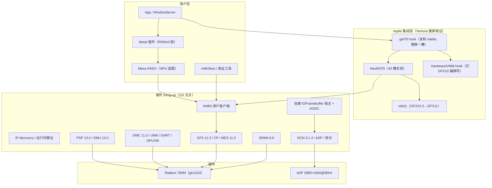

# 00-总体路线

## 0. 册头：编写意图、读者与文档体系

### 0.1 编写意图

本册是全项目的入口文档，回答一个问题：**如何以 Cobalt64 为基座，把"RDNA4 独显 + Tahoe"的驱动改造成"RDNA3 核显 780M + Ventura 13.7.8"的日常可用驱动。**

它不是代码、不是补丁。它给出：八册文档体系的导航、全局统一说法、已定决策记录、阶段总览、验证体系、风险登记、术语表与参考文献总汇，以及硬件基线、寄存器速查、失败模式库、任务卡模板四份全局附录。

**本册与其它册的关系**：本册给出全局框架与总汇；各阶段的目标、任务卡、通过标准、证据要求在对应阶段册（10–16）中展开；硬件取证的过程与细节在 10 册。本册正文精炼，避免成为第二份大文档；但附件表与参考文献全量保留，作为这些内容的全局唯一出处。各阶段册引用文献时注明"文献表见 00-总体路线.md §13"。

本文档体系的约束经项目启动前的问答对齐确定；同时纠正了两处对 Cobalt64 的事实性误读（审核结论见 10 册 §1.1）。

### 0.2 项目最高原则（优先级 1，所有技术取舍的裁决标准）

1. **遇到问题必须思考正统的解决方案，遵循各组件的原始设计意图/抽象层次设计**：一切决策、解决问题的方法，必须思考正统的解决方法是什么，思考设计意图是什么，比如 Apple 的设计意图（如 TTL 上层通用/下层按卡替换）、AMD 的设计意图（如 IP discovery 运行时基址）等，绝对禁止图省事而走任何野路子、绕过的方案（那会带来无穷的问题）。在尊重其原始设计意图的前提下，进行针对性适配。
2. **理解透彻设计意图的前提下，选择最适合的小改动/方案，而非复杂的补丁方案**：修改侵入面尽量小。理解透彻原始设计意图为准。
3. **每个步骤失败可回退、不 panic**。错误设计必须规范且严谨，日志齐全，避免出现 panic 的情况。交付的东西要稳定可回退，不把实验性风险带进日常。
4. **性能要得到保障**：在遵循上述原则的基础上，不做牺牲性能的事情、架构决策。

### 0.3 读者与阅读路径

| 读者 | 建议阅读 |
|---|---|
| 项目决策者 | 本册 §0–§4、§10、§11 |
| 接手的新 AI 会话 | 本册全册 + 对应阶段册 |
| 写代码的 AI | 本册 §5–§9 + 对应阶段册 |
| 上机操作的人 | 本册 §0.5、§8.6、附录 A–C |

默认读者具备 macOS 内核扩展、IOKit、AMD GPU 驱动的基本概念；不要求读过 Cobalt64 源码。术语首次出现时在正文解释，汇总见 §12 术语表。

### 0.4 八册文档体系导航

| 册 | 文件 | 内容 | 状态 |
|---|---|---|---|
| 00 | `00-总体路线.md`（本册） | 全局框架、决策记录、阶段总览、验证体系、风险、术语、文献、附录 A–D | 现行 |
| 10 | `10-阶段0-取证与基线.md` | 阶段 0：静态取证、SSH 取证、探针、三问结论、硬件基线取证过程 | 已完成并归档 |
| 11 | `11-阶段1-fork与骨架.md` | 阶段 1：fork、双目标构建、共享层解耦、IP discovery、只读 survey、安全网骨架 | 已完成并归档 |
| 12 | `12-阶段2-上电与固件.md` | 阶段 2：PSP/SMU/GFX/SDMA/MES 五 IP 上电与固件加载 | 已完成并归档 |
| 13 | `13-阶段3-内存与队列.md` | 阶段 3：GMC/UMA/GART/GPUVM、队列提交、compute 闭环 | 未开工 |
| 14 | `14-阶段4-显示与加速.md` | 阶段 4 两篇：4a 显示宿主（IOFramebuffer/DisplayPipe/AGDC/背光/接管与回退）、4b Apple 集成层（TTL 对象创建、vtable 槽位取证、xlat11、HardwareHook GFX11 偏移表、加速器激活、IOGraphicsAccelerator2） | 规划 |
| 15 | `15-阶段5-Metal.md` | 阶段 5：RADV APU 适配、Metal 插件、WindowServer GPU 合成 | 规划 |
| 16 | `16-阶段6-日常化.md` | 阶段 6：硬解、睡眠、外接、性能基准、长稳 | 规划 |

配套文档见 §13.1 文档索引。

### 0.5 生产机验证原则（6 条）

**背景**：当前验证在用户的日常生产机上进行，没有别的机器。故项目代码必须设计完备，不得随意让生产机器 panic，也不得提高部署测试成本。所使用的策略包括但不限于：

1. **先只读、后写入**：每轮先做只读门槛（状态/体检/可见性/进度）；门槛不全过不触发。
2. **证据先落盘**：触发前必须建立持久进度通道（launchd 托管；禁止 nohup/前台超时）；冻结后以落盘进度为最后完成步。
3. **一次开机一次触发**：同 boot 不重复触发；失败即停，不自动重启。
4. **人在场**：操作者在场；强制关机是最后手段，不是常规流程。
5. **人工不合盖**：当前没有 kext 级防睡眠断言，验证期间不得合盖/睡眠。
6. **触发一律手动、部署后由主 agent 执行**：开发阶段（阶段 2–5，含日常化之前的全部真机验证）的每一次上电/功能触发，都必须由主 agent 在部署完成后通过管理员权限用户客户端手动触发；**禁止开机自动触发**（`n48r3-auto=1` 及其等价形态在开发阶段不得启用）。理由：开机自动路径一旦失败会形成"每次开机都失败"的循环；而触发是最需要人在场、可判读、可及时停止的时刻——这正是 F12 两形态分离的设计意图。

### 0.6 流程词首次说明

以下流程词在各册中反复使用，此处统一给出一句话解释（硬技术词见 §12 术语表）：

- **取证**：以只读方式从真机或二进制中提取事实并归档，供后续阶段引用与复核。
- **探针**：临时部署的只读观测 kext，用于在真机验证某个假设，验证后移除、系统回到原生状态。
- **回退**：某个功能路径失败时，用 boot-arg 或 NVRAM 标记把它关闭、退回上一稳定状态的手段。
- **阶梯**：把一个大阶段拆成由浅入深的执行深度等级（如 `n48r3-stage=N`），每级失败即停。
- **触发**：在真机上启动某次验证动作的操作；本项目一律手动触发（见 §0.5 第 6 条）。

## 1. 背景与基线摘要

### 1.1 目标机器与系统（事实摘要）

所有寄存器值、固件版本、面板参数都以这台机器为准。取证过程与证据指针见 10 册；此处只给结论性事实。

| 项 | 值 | 状态 |
|---|---|---|
| 机型 | ThinkBook 14+ 2023 锐龙版 | 已确认 |
| CPU | Ryzen 7 7840H（8 核，5.1GHz，Phoenix 平台） | 已确认 |
| GPU | Radeon 780M，RDNA3，gfx1103，GC 11.0.1 | 已确认（kernel.org + OpenBSD 交叉验证 + IP discovery 实测 39 IP 全表） |
| device id / revision | 0x15BF / 0x00C7 | 已实测（ioreg） |
| 面板 | 14" IPS 2880×1800@90Hz；EDID 实测 AUO B140QAN04.0，首选模式 2880×1800@90.006Hz | 已实测 |
| eDP 链路 | DPCD rev 1.4 / HBR2 / 4 lanes；DSC 未见于基础 EDID | 已实测 |
| 内存 | 32GB LPDDR5-6400 板载；UMA carveout 实测 4096 MiB | 已实测 |
| 独显 | 无 | 已确认 |
| 无线 | MediaTek MT7921（pci14c3,7961）；macOS 原生无驱动，SimpleMtkWlan 已驱动 | 已实测 |
| BIOS | AMI；UMA Frame Buffer Size 可能隐藏，可用 UAMF 调 | 待取证 |
| 目标系统 | macOS Ventura 13.7.8（用户明确要求；Tahoe 不稳定会降级） | 已确认 |
| OpenCore / SIP | OC 1.0.7；SIP=Custom 0x0a03 | 已确认 |
| 背光路径 | GPU MMIO（DIO link-encoder PWM）；PWM 现状实测 pwrseq0 enabled=1 level=65536 period=4000 bitcnt=12 | 实测+反汇编双证据 |
| PCI/BAR | BAR0=0x8_D000_0000+256MiB、BAR2=+2MiB、BAR5=0x7810_0000+512KB | 已实测（SSH） |

**日常使用的硬前提**：原装无线网卡在 macOS 无驱动。日常网络走 RJ45 或 USB 网卡；换 Intel AX210 是可选升级，不作为首期目标。

### 1.2 Cobalt64 基座摘要

Cobalt64 是开源的 macOS AMD 显卡驱动 [1]，目标硬件 RDNA4 独显（RX 9070 XT / Navi 48），基线 macOS Tahoe 26.6.2。它不是从零写驱动，而是四层胶水（规模为源码行数，均经核实）：

| 层 | 作用 | 关键代码 | 规模（行） |
|---|---|---|---|
| 硬件 bring-up | PCIe/BAR、IP discovery、PSP/SMU/GMC/GFX/SDMA/MES 上电、DCN 4.1 显示 | `src/navi48-bringup/src/amd/`、`src/navi48-bringup/src/dcn/` | amd 22,629 + dcn 12,167 |
| Apple 集成 | TTL 43 槽实现、getTtl hook、Hardware/VMM hook、显示对等端 | `src/navi48-bringup/src/apple/` | 44,295（其中 AppleHardwareHook.cpp 34,906） |
| 命令翻译 | GFX10.3→GFX12 寄存器/命令流翻译 | `src/xlat12/` | 23,920 |
| 用户态 | RADV Darwin 后端（9 个 Mesa 补丁）、Metal 插件、N48N 用户接口 | `mesa-patches/`、`tools/native/` | 补丁 10,554 行 |

**Apple 集成层的机制**（理解全项目的钥匙，细节见 10 册）：

- Apple 的 `AMDRadeonX6000` 加速器是 generation-agnostic 的：不直接写 GPU 寄存器，所有硬件操作通过 `AmdTtlServices` 接口（一张 C++ 虚函数表）委托给下层。TTL 共 43 个槽位，其中 16 个被加速器实际调用（`AmdTtlServicesABI.h:37` [2]）；Cobalt64 的 `Navi48Ttl` 覆盖全部 43 个 [3]。
- Apple 下层实现 `AMDRadeonX6000HWLibs` 只支持到 Navi 23（RDNA2）。Cobalt64 自己实现 TTL，并 hook `HWServices` 函数表第 266 格（`getTtl()`）[4]，让加速器拿到自己的 TTL 对象。
- Apple 上层少数高频捷径（刷缓存、失效页表）把 GFX10 寄存器地址写死在代码里；Cobalt64 换掉下层后前提被打破，故 hook `Hardware`/`VMM` 的相关槽位 [5]（62 flushHDP、93 getVmm、102 registerChannel、187 allocHWRegs、191 setVMRegs、247/248 hub、36 regWrite 与 35 regRead——MMIO 读路径同样被拦截并走影子缓存；VMM 71 programAndInvalidate、40/41 VMContext、37 unmapVA），把捷径引到正确实现。不拦的后果是内核死等应答、整机挂死（0.0.52 真实发生过）。
- 命令流翻译 `xlat12` [6]：Apple 发出 GFX10.3（RDNA2）方言的 PM4 命令流，翻译器逐条查表改写成 GFX12（RDNA4）方言。六类规则：identical/moved/field_repack/absent/reused/legacy_vs；GFX12 只有 NGG 顶点路径，legacy VS 拒绝。表由 Mesa 的 `gfx103.json`+`gfx12.json` 生成（固定 commit 4519cc56），reused 表手写（2 条映射）。

**显示层的真实结构**（三层，纠正"显示层复用 RDNA4FB 的 IOFramebuffer"的误读）：

1. **RDNA4FB**（外部项目 [38]）：IOFramebuffer 宿主，接管固件 GOP 延续的扫描输出，持有 `Console,*` 几何属性。Cobalt64 从它读扫描输出几何、把 GPU 渲染结果拷进它的扫描输出缓冲、把 `Navi48DisplayPipe` 挂在它的 display machine 上。它是显示宿主，不是被复用的库。
2. **DCN 4.1**（Cobalt64 自写 [7]，`src/dcn41/` 3,410 行 + bringup 内部 `dcn/` 12,167 行）：显示引擎的硬件编程。模式设置走 verb 序列，寄存器层由 Linux dcn_4_1_0 头文件生成，带写白名单与 host 测试。封装边界：dcn41 层只封装 OTG/HUBP/IRQ/DMUB；stream-encoder（DIO/DIG）编程开放编码在 disp2 的 connect 步骤、AUX/DC_I2C 由 DDC 读取路径直接操作引擎——RDNA3 的 dcn314 层没有现成的 DIO/AUX 封装可移植。
3. **aux kext** [8]（`tools/native/navi48accel`）：`Navi48Framebuffer`（IOFramebuffer 子类）、`Navi48DisplayPipe`（IOAccelDisplayPipe trampoline，接住 WindowServer 的 present）、`Navi48AGDC`（自建 AppleGraphicsDeviceControl 对象）、`Navi48Accelerator`（IOAccelerator 子类，Metal 发布链路的宿主端；boot-arg `navi48-aux` 总开关）。

**其余已核实事实**：boot-arg 约 48 个（`navi48-*`；安全网的正确统一说法是"默认不加载"——`navi48bringup=0` 时驱动不 probe；加载后实验性路径默认关、已验证路径默认开）；host tests + planted break 体系；固件 10 个 `.bin` 编译期嵌入（`gc_12_0_1_*` 六个、`psp_14_0_3_*` 两个、`sdma_7_0_1`、`smu_14_0_3`），来自 linux-firmware；加载走 OpenCore + AuxKC。Cobalt64 无任何多目标（TARGET）构建机制，类名/文件名/boot-arg 族/日志前缀全部硬编码 Navi48——对 RDNA3 fork 的含义见 11 册。

### 1.3 nullarc 定位（全局统一说法）

nullarc [37] 是**同 IP 版本（GC 11.0.1）对照基准**：唯一已在 780M 上实机验证"上电→内存→队列→Vulkan→Metal"全链的开源项目。

- **其实测机**：Firebat U6C / Ryzen 7 H 255 / PCI 1002:1900 rev 0xBA / VBIOS 113-PHXGENERIC-001 / GC 11.0.1（上游 README 机型表述不一致，以 ip_discovery 实测为准）。
- **本机**：ThinkBook 14+ / 0x15BF。两者是**不同机器**，全文禁止出现"同机实证"表述。
- nullarc 的平台相关数值（TMR 64 MiB、GB_ADDR_CONFIG 0x242、PMFW 76.101.0 / driver-if 8、MC aperture 0x80_xxxxxxxx、BAR0 等）**不作本机真值，引用处标注"需本机复核"**。
- 可直接参照的部分：流程顺序（bring-up 序列、上电顺序）、陷阱清单、安全网设计（phxboot fail-safe）、OS 侧显示机制（PhxAMDFB/PhxAGDC）。

### 1.4 三重变化

| 维度 | Cobalt64 基线 | 本任务目标 | 性质 | 主要影响 |
|---|---|---|---|---|
| GPU 世代 | RDNA4（GC 12.0.1、DCN 4.1、PSP 14.0.3、SMU 14.0.3、SDMA 7.0.1、MES 12.1、VCN 5.x） | RDNA3（GC 11.0.1、DCN 3.1.4、PSP 13.0.4、SMU 13.0.4、SDMA 6.0.1、MES 11.0、VCN 4.0.2） | 移植 | 每个 IP 一套新文件；寄存器表、固件、上电序列 |
| 形态 | 独显（独立 VRAM、ReBAR、外接显示） | APU（UMA carveout、eDP 内屏、背光、电源管理） | 重写内存/显示模型 | GMC/GART/GPUVM、扫描输出、EDID/AUX、背光 |
| 系统 | Tahoe 26.6.2 | Ventura 13.7.8 | 重新逆向 | TTL vtable、Hardware/VMM hook、personality、加载/签名 |

前两者是移植，第三者是重新逆向——Apple 侧重新取证已完成（静态取证 + 运行时取证均已完成并归档，见 10 册）。

### 1.5 首期边界与"日常可用"的定义

**首期（阶段 0–5）必须达到**：

- 内屏 2880×1800@90Hz 点亮，桌面稳定；
- **背光可调**（亮度键/滑块；亮度控制走 GPU MMIO——DIO link-encoder PWM）；
- WindowServer 用 GPU 合成（CoreAnimation 走 780M）；
- Safari、Chromium/Electron、办公 App 正常渲染；
- 系统能启动、登录、关机/重启；GPU hang 可回退。

**首期不做**：硬件视频编解码（VCN 4.0.2）、睡眠/唤醒、外接显示、游戏与 GPU 计算、多显示器、安装器与公开分发（详见 §11）。

**"日常可用"的诚实定义**：首期结束时可用于浏览器、文档、终端、轻度开发；不能视频硬解播放、不能合盖睡眠、不能接外屏。阶段 6 补齐。

## 2. 总体技术路线

### 2.1 三层解耦模型

把 Cobalt64 拆成三层，分别决定"保留/替换/重写"：

| 层 | 与 OS 的关系 | 与 GPU 世代的关系 | 本任务策略 |
|---|---|---|---|
| 硬件 bring-up | 弱 | 强（每个 IP 一套） | **移植**：以 Linux amdgpu 的 Phoenix 支持为主源，按 IP 版本新增文件；nullarc 实证数据作验证基准 |
| Apple 集成 | 强（vtable/符号/加载） | 中（TTL 是 generation-agnostic，hook 的寄存器偏移是 GFX10） | **重新取证**：Ventura 的 TTL/Hardware/VMM 结构；TTL 可用则复用，不可用转备选 |
| 用户态 | 强 | 中（RADV 支持 gfx1103，Darwin 后端要适配 APU） | **适配**：RADV APU 堆、Metal 插件、DCN 3.1.4 扫描输出 |

价值：每层独立验证、独立回退；一层的失败不污染其他层。

### 2.2 以 Cobalt64 为基座：保留什么、替换什么

**保留（不改或小改）**：四层架构与模块边界；TTL 的 ABI 形状与 hook 方法；xlat 的"表驱动 + 规则审查"方法；DCN 寄存器层的"生成 + 写白名单 + host 测试"方法；boot-arg/latch off/日志 trail/kill switch 的工程习惯；host 测试与 planted break；RADV Darwin 后端的整体形状。

**替换（新增一套，不改旧的一套）**：

- IP 层：新增 `*_v11_0.cpp`/`*_v13_0.cpp`/`*_v6_0.cpp`；旧 `*_v12_0.cpp` 等保留给 RDNA4 分支。
- `src/xlat12/` → 新增 `src/xlat11/`（GFX10.3→GFX11），生成器复用，输入换 Mesa gfx11 寄存器库。
- `src/dcn41/` → 新增 `src/dcn314/`，生成器复用，输入换 Linux dcn314 头文件。
- Apple 集成层：按 OS 版本隔离（`apple/ventura/`），Tahoe 实现保留。取证结论：Ventura 的 TTL ABI 与 Tahoe 逐槽对齐、getTtl 同号 266——`AmdTtlServicesABI.h` 直接复用；Hardware/VMM 尾部 4 个 hook 槽位按 Ventura 实测值微调。
- 显示宿主：新增自建 IOFramebuffer（RDNA4FB 的替代）。
- 用户态：RADV 补丁新增 APU 适配；Metal 插件新增 RDNA3 设备描述。

**不改路线**：默认仍是"复用 Apple 加速器 + TTL + xlat"。备选"自写 IOAccelerator"只在取证失败时启用并需批准。

### 2.3 取证驱动与三问论证（go/no-go）

阶段 0 回答三个问题（go/no-go 即"做/不做"的决策点）：

1. Ventura 13.7.8 的 Apple 驱动是否仍以 TTL 为硬件抽象？槽位结构、`getTtl()` 位置、类名/符号可否解析？
2. Apple 加速器是否仍 generation-agnostic（只通过 TTL 摸硬件）？
3. APU 的 UMA 能否呈现为 Apple 加速器可用的 VRAM/GART？

答案决定路线：三个"是"→ TTL 路线（默认）；1 或 2 为"否"→ 自写 IOAccelerator 备选（需批准）；3 为"否"→ 先解决 UMA 呈现，解决不了暂停。

**当前答案状态**（证据细节见 10 册）：

- **问题 1：是（已确证）**。Ventura 的 TTL 43 槽与 Tahoe ABI 逐槽对齐、getTtl 同为 slot 266。TTL 作为硬件抽象在 Ventura 依然成立，且契约与 Cobalt64 已实现的完全兼容。
- **问题 2：是（已确证）**。反汇编显示加速器唯一的寄存器写入口是 `AMDHWRegisters::write`（TTL slot 36），寄存器基址全部来自 TTL slot 11 的查询——即加速器自己不知道寄存器地址，只通过 TTL 摸硬件。旁证：NootedRed 在本机 hook slot 266 后加速器确实全程经 TTL 走（113 hook 点生效、10 次 ttl query），未观察到绕过 TTL 的寄存器写。运行时验证：探针两次 boot 实测 16 槽位计数全 0（加速器未激活路径），未观察到任何绕过 TTL 的寄存器写。
- **问题 3：拓扑兼容（精确 carveout 由阶段 1 survey 补齐）**。SSH 取证确认 BAR0 aperture（256MiB）位于 32GiB 物理内存之上——与 nullarc 实证同构；探针实测 TTL 对象在无驱动绑定状态下成功创建（Apple 内存模型初始化无内存相关失败）；精确 carveout 数值的读取受 D2 电源门控时序影响（两次 boot 实测），由阶段 1 survey 在自写驱动的 D0 上下文补齐。

go/no-go 最终签字需要问题 3 的运行时证据（决策树见 10 册）。

### 2.4 架构图：分层与介入点



介入点按侵入性从低到高：TTL 槽位（低）→ Hardware/VMM vtable（中）→ 命令流翻译（中）→ 显示宿主/AGDC（中高）→ 自写加速器（高，仅备选）。

### 2.5 关键设计决策

| 决策 | 选择 | 理由 | 风险 |
|---|---|---|---|
| 代码组织 | `rdna3` 工作分支 + 共享模块；IP 层按版本新增文件；Apple 层按 OS 版本隔离 | 上游变化快，分支隔离减少 merge 冲突；保持"单目标硬编码"风格 | 共享模块接口变更影响两分支 |
| 构建 | 双目标：`TARGET=rdna4`（默认）与 `TARGET=rdna3` | RDNA4 可回归；RDNA3 不破坏上游 | Makefile 是 merge 热点 |
| Apple 层 | TTL 优先（TTL ABI 已确证与 Tahoe 对齐）；0b 验证运行时行为；备选自写加速器 | 复用 Apple 加速器 = 顺着 Apple 的抽象层次设计（上层通用/下层替换），侵入面最小；自写加速器是最后手段 | R1（已排除） |
| 合成机制 | 走正统 Apple 加速器路径（IOGraphicsAccelerator2 + xlat 翻译），不走 nullarc 的 Metal 插件合成路径 | 尊重 Apple 的合成器设计意图；验收采用 Apple 路径对应的通过标准（IOGraphicsAccelerator2 服务出现、xlat 翻译计数、合成器走加速器） | R14/R15 |
| 显示宿主 | 自建 IOFramebuffer（GOP 延续 + DCN 同模式接管） | RDNA4FB 不可用；nullarc 已验证 GOP 接管的 OS 侧机制 [37] | R4 |
| 显示扫描输出 | DCN 3.1.4 同模式接管 + 硬件翻页；CPU 拷贝不进交付路径 | 固件已配好显示引擎（OTG 在计数）；同模式接管避免冷启动风险；无 CPU 拷贝硬伤 | R4 |
| 背光 | 首期包含；亮度控制走 GPU MMIO（DIO link-encoder PWM）——SSH 实测 PNLF 为无 _BCL/_BCM 方法的壳设备（ACPI 方法路径不通）+ Apple 原生驱动反汇编证实 MMIO 路径；由自建显示宿主直接编程 DIO PWM | 用户要求；实测+反汇编双证据 | R4/R12 |
| 加载 | OpenCore 注入优先；0a 不动 SIP/AMFI，0b 必要时最小调整 | 侵入面最小：先证明必须动，再动；动多少写多少 | R9 |
| 安全网 | Cobalt64 机制 + nullarc phxboot fail-safe（NVRAM 标记） | 双重保险，都有实证 | — |
| 验证 | host 测试 + 真机 smoke + 通过标准（命令/寄存器/日志） | 与 Cobalt64 一致 | — |
| 代码复用 | 个人自用不公开；nullarc/NootedRed 等可复用，标注来源 | 个人自用前提下无许可证负担；复用是正大光明的（标注来源），不是省事 | R13 |

### 2.6 主要难点

1. **Ventura 的 Apple 侧 hook 精度**：TTL 结构已取证（43 槽对齐、getTtl=266），但 hook 是"复制 vtable、替换槽位"的运行时操作——槽位号对不上一格就会 hook 到错误函数，轻则功能缺失重则内核挂死（Cobalt64 在 Tahoe 上 0.0.52 的真实教训）。Ventura 已实测的槽位号必须经 0b 探针在真机验证生效后才可用于阶段 4b 的 hook 实现；锚点几何（用邻近符号定位目标函数的手法）也要按 Ventura 地址重算。
2. **APU 的 UMA 与 Apple 的 dGPU 假设冲突**：Apple 加速器假设"独立 VRAM + GART"；APU 的 VRAM 是系统内存 carveout。GMM 回调、AMDHWVMM、GART 路径都要适配。
3. **xlat11 不是"换一张表"**：GFX11 只有 NGG 顶点路径（与 GFX12 同规则，可复用审查方法）、scissor 的 BR 语义、reused 同地址覆盖、字段映射差异。表可生成，规则逐条审。
4. **显示宿主自建**：RDNA4FB 的角色（GOP 延续 + Console,* 几何 + display machine 宿主）要自己实现；nullarc 的 PhxAMDFB 证明了可行性，但它的实现绕过了显示引擎，我们要接 DCN。
5. **DCN 3.1.4 同模式接管**：读快照易，翻页寄存器写错即花屏；AUX/EDID/DPCD、背光路径都要取证。
6. **单机调试**：只有目标机，GPU hang 时构建环境一起挂；日志是主要证据。
7. **上游快速演进**：merge 冲突集中在 Apple 层和 Makefile。

## 3. 已定决策记录表

以下决策已在项目过程中定案，各册必须一致执行。

| 编号 | 决策 | 结论 | 执行位置 |
|---|---|---|---|
| Q1 | 合成机制 | 走正统 Apple 加速器路径（IOGraphicsAccelerator2 + xlat 命令翻译 + 自实现 TTL），不走 nullarc 的 Metal 插件合成路径；阶段 4 相应拆分为 4a 显示宿主与 4b Apple 集成层两篇，各有进入条件与通过标准 | 14 册 |
| Q2 | 阶段 3 组织 | 保持单一阶段（内存与队列不拆分）；开工前先写需求文档（沿用阶段 2"需求文档先行"的做法） | 13 册 |
| Q3/Q9 | 文档体系 | 文档体系为 8 册平铺文档（00+10–16） | 本册即 00 |
| Q4 | soak 阶梯 | 阶段 3=单次开机全通过；阶段 4（4a、4b 分别）=连续 ≥30 分钟 × 2 次开机；阶段 5=8 小时长稳；阶段 6=1 周日常使用 | §4 阶段总览 |
| Q5 | 首期定位 | 首期功能为主，性能只设守门指标：fence 完成延迟 <1ms；vkprobe 256/256 通过；窗口拖动无可感知卡顿；90Hz 实际扫描无降档。完整性能基准归阶段 6 | §4、14/15 册 |
| Q6 | nullarc 定位修正 | nullarc 为同 IP 版本（GC 11.0.1）对照基准，非"同机实证"；其平台相关数值一律标注"需本机复核" | §1.3 |
| Q7 | 事实修正原则 | 遗留项与实测值冲突时以实测值为准（EDID：AUO B140QAN04.0 首选 2880×1800@90.006Hz；DPCD 1.4/HBR2/4 lane；UMA carveout 4096 MiB——均为本机实测事实）；加速器激活归属阶段 4b（非阶段 1） | 附录 A、14 册 |
| Q8 | 轮次史处理 | 开机轮次流水账（R1–R6）压缩为"已知失败模式"表条目（现象→根因→处理） | 附录 C |

## 4. 阶段总览（阶段 0–6，含 4a/4b）

| 阶段 | 目标 | 核心内容 | soak 要求 | 状态 | 详细册 |
|---|---|---|---|---|---|
| 0 取证 | 回答三问、建立基线 | 静态反汇编 + SSH 取证 + 探针三次部署；go/no-go 结论 | —（只读取证，按 10 册结案标准） | 已完成并归档 | 10 |
| 1 fork 与骨架 | 双目标构建 + 只读 survey | fork、共享层解耦、IP discovery、安全网骨架；GPU 保持 GOP 点亮、驱动零写入 | —（按 11 册结案标准） | 已完成并归档 | 11 |
| 2 上电与固件 | 五 IP 依次 ready | PSP 13.0 / SMU 13.0 / GFX 11.0 / SDMA 6.0 / MES 11.0 上电与固件加载 | —（按 12 册结案标准） | 已完成并归档 | 12 |
| 3 内存与队列 | GPU 能算 | GMC 11.0 / UMA / GART / GPUVM、队列提交与 fence、compute 闭环 | 单次开机全通过 | 未开工 | 13 |
| 4a 显示宿主 | 桌面可用（显示侧） | 自建 IOFramebuffer / DisplayPipe / AGDC、DCN 3.1.4 同模式接管、背光、接管与回退；完成口径含"看起来正常的 Mac"（软件合成下桌面完全可用） | 连续 ≥30 分钟 × 2 次开机 | 规划 | 14 |
| 4b Apple 集成层 | 加速器激活 | TTL 对象创建、vtable 槽位取证、xlat11、HardwareHook GFX11 偏移表、加速器激活、IOGraphicsAccelerator2 | 连续 ≥30 分钟 × 2 次开机 | 规划 | 14 |
| 5 Metal | 日常可用 | RADV APU 适配、Metal 插件、WindowServer GPU 合成、App 渲染 | 8 小时长稳 | 规划 | 15 |
| 6 日常化 | 完全日常 | 硬解、睡眠、外接、性能基准、长稳 | 1 周日常使用 | 规划 | 16 |

## 5. 模块改动原则与分布

此处为原则与分布说明，文件级详细清单指向各阶段册。

### 5.1 改动原则

1. **新增文件不改旧文件**：IP 层按版本新增 `*_v11_0.cpp`/`*_v13_0.cpp`/`*_v6_0.cpp` 等；旧 `*_v12_0.cpp` 等保留给 RDNA4 分支。
2. **共享代码进 `common/`**；`TARGET=rdna3` 只编译新文件（双目标构建，RDNA4 可回归）。
3. **Apple 集成层按 OS 版本隔离**（`apple/ventura/`），Tahoe 实现保留；`AmdTtlServicesABI.h` 直接复用（Ventura 43 槽与 Tahoe 逐槽对齐，已验证）。
4. **生成器复用、输入替换**：xlat11 表由 Mesa gfx11 json 生成（复用 xlat12 生成器）；dcn314 寄存器层由 Linux dcn314 头文件生成（复用 `tools/dcn41/` 生成器）。
5. **必须从零实现的部分**：`dcn314_dio.c`/`dcn314_aux.c`（dcn41 无对应封装可移植）；显示宿主 `src/navir3-fb/`（RDNA4FB 不可用于 RDNA3）。
6. **用户态适配**：mesa-patches 新增 APU 识别、堆/内存类型、DCN 3.1.4 scanout、兼容性（参照 nullarc `mesa-patches-phoenix/`，7 个补丁 488 行）；Metal 插件 `navir3metal`（设备描述/格式表/scanout 对接）。
7. **加载与签名**：OpenCore `Kernel->Add` 优先 → AuxKC + `kmutil`（可能需 `amfi=0x80`）→ 最小调整集；恢复步骤成文。

### 5.2 详细清单位置

| 模块 | 详细清单位置 |
|---|---|
| bringup IP 层（文件级） | 11 册（fork/骨架）+ 12 册（上电各 IP）+ 13 册（GMC/队列） |
| Apple 集成层 | 14 册（4b） |
| xlat11 | 14 册（4b） |
| dcn314 | 14 册（4a） |
| 显示宿主（`src/navir3-fb/`） | 14 册（4a） |
| mesa-patches 与 Metal 插件 | 15 册 |
| 加载与签名 | 11 册（TC-20） |
| 工作量与依赖 | 各阶段册任务卡 |

## 6. fork 与上游管理

分支模型见 11 册。merge 节奏按需（触发条件见 11 册）；冲突热点 Makefile/`src/apple/`/`tools/`；merge 后跑 RDNA4 构建 + host 测试；上游改 TTL ABI 时先更新 Ventura 版再合并。

**代码复用与来源标注**：个人自用不公开分发，复用不受许可证限制；主源 Linux amdgpu（寄存器序列/IP 版本/固件流程）；交叉验证与可复用：nullarc [37]（780M 实证：bring-up 序列、寄存器值、陷阱清单、安全网）、NootedRed [29]（APU + Ventura TTL 经验）、RDNA4FB [38]（显示宿主结构）、mac-amdgpu [39]（固件加载/IP discovery）、Raphaeli [30]（通过标准）、metal2vulkan [31]（AIR→SPIR-V）。每个复用片段文件头注明来源——工程卫生，便于回溯。

**许可证**：Cobalt64 MIT 沿用；Mesa 补丁 MIT；metal2vulkan/n48xlate LGPL-3.0 独立目录保留 NOTICE；AMD 固件不随仓库分发；nullarc PolyForm-NC、NootedRed ChefKiss——个人自用，复用片段标注；未来公开需重审替换。

## 7. 验证体系

### 7.1 验证层次

| 层次 | 内容 | 频率 |
|---|---|---|
| host 测试 | 纯函数、ASan/UBSan、golden、fuzz、planted break | 每次提交 |
| 构建检查 | 双目标构建；`nm -u`；无 SSE/x87 | 每次提交 |
| 真机 smoke | 每阶段通过标准 | 每阶段 |
| 回归 | RDNA4 构建 + host 测试（每次上游 merge 后必跑） | 每次按需 merge 后 |
| 长稳 | 连续 8 小时起（阶段 5 soak）；阶段 6 起长期统计 hang/panic | 阶段 5 起 |

通过标准（原称 PASS 判据）的统一说法借鉴 Raphaeli `AGENTS.md` 与 RDNA4FB `real-card-plan`：每项明确 PASS/FAIL/SKIPPED；失败必须带证据（命令输出/寄存器值/日志行）。

### 7.2 每阶段三要素汇总（前提依赖 / 完成标志 / 回退 / soak）

| 阶段 | 前提依赖 | 完成标志（系统走到哪一步） | 回退 | soak |
|---|---|---|---|---|
| 0 取证 | 目标机可启动；SSH 可达 | 取证全部完成（静态+SSH+探针三次部署）；go/no-go 决策结论在 10 册；系统保持原生状态（探针已移除） | 0a 无需回退；探针可卸载（已实证） | — |
| 1 骨架 | 阶段 0 报告签字；构建环境就绪 | 只读 survey 通过；GPU 仍是 GOP 点亮状态，驱动零写入 | `n48r3bringup=0` / `n48r3-stage=0` | — |
| 2 上电 | 阶段 1 survey 通过；固件嵌入完成 | 五 IP 依次 ready；GPU 从冷状态变为已上电可执行（"GPU 活了"） | 各子步 boot-arg + 逆序 teardown | — |
| 3 内存/队列 | 阶段 2 全 ready；UMA 取证在手 | compute magic 正确；CPU→GPU→CPU 闭环打通（"GPU 能算"） | `n48r3-gart/mes/queue=0` | 单次开机全通过 |
| 4a 显示宿主 | 阶段 3 compute 通过；DCN 快照在手 | 内屏点亮 + 背光可调；"看起来正常的 Mac"（软件合成下桌面完全可用） | `n48r3-dcn=0` + NVRAM 标记自动回退 | 连续 ≥30 分钟 × 2 次开机 |
| 4b Apple 集成层 | 4a 显示宿主通过；Ventura TTL 取证在手 | IOGraphicsAccelerator2 服务出现、xlat 翻译计数生效、合成器走加速器（WindowServer GPU 合成，"桌面可用"） | 关闭 hook/xlat boot-arg 回 4a 软件合成；NVRAM 标记自动回退 | 连续 ≥30 分钟 × 2 次开机 |
| 5 Metal | 阶段 4 合成通过；ABI/compute 通过 | App 渲染走 780M；首期验收达成（"日常可用"） | `n48r3-metal=0` + hang 自动恢复 | 8 小时长稳 |
| 6 日常化 | 阶段 5 验收达成 | 硬解/睡眠/外接/长稳（"完全日常"） | 每子项独立开关 | 1 周日常使用 |

### 7.3 质量把控机制（吸收两项目实证）

| 机制 | 来源 | 在本项目的应用 |
|---|---|---|
| 阶段阶梯（`navi48-stage=N`，17 阶） | Cobalt64 `BringupStage` | `n48r3-stage=N` 控制执行深度；每阶失败即停 |
| 失败即停 + 诊断转储 | Cobalt64 `bringup_to`/`dump_failure_state` | 每阶失败自动 dump VM fault/IH；后续阶段不执行 |
| 逆序 teardown | Cobalt64 `bringup_teardown` | 失败按上电逆序清理；不 GPU reset（护显示）；PSP 留活 |
| 阶段自检 | Cobalt64 stage16 PM4Test / stage17 ComputeDispatch | 阶段 3 内嵌 PM4 级 + compute 级自检，过了才进用户态 |
| 发布进入条件 | Cobalt64 accel-gate（compute 过才发布设备） | 阶段 5 的 Metal 设备发布以自检通过为前提 |
| 五腿自检 | Cobalt64 S1b（低/高/混合/compute/故意 fault） | 阶段 3 的 VM 子系统自检清单 |
| 同模式验证 | Cobalt64 dcnmode=1（写回→重拍→逐 dword 比对） | 阶段 4 的零风险 DCN 理解性验证 |
| 翻页证据链 | Cobalt64 dcnflip witness（CRC/pending/EARLIEST/计数器/地址恢复） | 阶段 4 翻页的 5 项证据标准 |
| 帧计数器看门狗 | Cobalt64 scanx watchdog（50ms 轮询→emergency restore） | 阶段 4 翻页挂死自动恢复 |
| 中断风暴保护 | Cobalt64 storm guard（超 20 万关中断源） | 阶段 4 VBL 中断保护 |
| 健康检查 + kill file | Cobalt64 autoarm（30s 轮询→noflip） | 阶段 4/5 的运行时急停通道 |
| NVRAM 标记 fail-safe | nullarc phxboot（panic 自动回固件帧缓冲） | 显示失败的下次 boot 自动降级 |
| hang 自动恢复 | nullarc phxboot（5min 2 次/1h 3 次→重启回退） | 阶段 5 的会话中 hang 处理 |
| 白名单分发 | nullarc allow.txt（`*`/`-name`/`!name`） | 阶段 5 Metal 设备按进程分发 |

### 7.4 失败处理流程与回归

**失败处理流程**：记录（日志/寄存器快照/IH/VM fault/boot-arg）→ latch off（本 boot 关闭该路径）→ 回退（关 boot-arg 回上一阶段）→ 回顾（失败模式入附录 C；设计问题回阶段 0 补取证）→ 不掩盖（不靠重试/忽略/放宽校验让失败消失）。

**回归与 planted break**：每个纯函数（xlat 规则、DCN 白名单、UMA 计算、fence 轮询）有 planted break；planted break 必须让测试失败否则测试无效；每次 merge 跑 RDNA4 构建；真机每次只改一个变量。

## 8. AI 协作框架

### 8.1 原则

1. 单 AI 上下文齐全：一个任务卡一个 AI；上下文包自包含，不依赖"之前的会话"（上下文工程原则 [32]）。
2. 任务不过于复杂：每卡一个模块/一个标准；跨模块拆多卡。
3. 人工把握大方向：路线、阶段边界、go/no-go、真机操作由人决定。
4. 通过标准可执行：命令/寄存器/日志，不是"看起来正常"。
5. 失败可回退：每卡有回退点；不允许"改到能跑为止"。

### 8.2 任务卡模板

```markdown
# 任务卡：<模块/阶段>
## 目标（一句话，可验证）
## 输入（上下文包：必读文件/寄存器表/日志样本/上游片段/已知失败模式）
## 输出（文件/函数/日志证据）
## 通过标准（命令/寄存器/日志关键字）
## 禁止（不猜偏移；不跨阶段；不默认开 boot-arg；不自动重启）
## 人工上机点
## 回退（boot-arg/文件）
```

### 8.3 任务卡分布指引

任务卡 TC-01～TC-21 按阶段归属分散进各阶段册；TC-22～TC-26 为阶段 4b 新增。各卡的目标、输入、通过标准在对应册内给出。

| 阶段册 | 任务卡 |
|---|---|
| 10（阶段 0） | TC-01（Apple 取证，已完成并归档）、TC-02（硬件取证，已完成并归档） |
| 11（阶段 1） | TC-03（fork/构建，双目标）、TC-03b（共享层解耦与命名路由）、TC-04（IP discovery）、TC-20（加载/签名，跨阶段 0/1）、TC-21（安全网） |
| 12（阶段 2） | TC-05（PSP 13.0）、TC-06（SMU 13.0）、TC-07（GFX 11.0）、TC-08（SDMA 6.0）、TC-09（MES 11.0） |
| 13（阶段 3） | TC-10（GMC/UMA）、TC-11（队列/ABI）、TC-12（compute） |
| 14（阶段 4a） | TC-13（DCN 3.1.4 寄存器层）、TC-14（同模式接管）、TC-15（显示宿主）、TC-16（背光） |
| 14（阶段 4b） | TC-22（TTL 对象创建与槽位取证表）、TC-23（vtable 槽位取证）、TC-24（xlat11 生成器）、TC-25（hook 安装）、TC-26（加速器激活验证） |
| 15（阶段 5） | TC-17（RADV APU）、TC-18（Metal 插件）、TC-19（WindowServer 合成） |

### 8.4 上下文包模板与每阶段上下文包

```markdown
# 上下文包：<阶段/模块>
## 必读文件（本仓库/上游 Linux/Mesa）
## 寄存器/表（IP discovery/偏移表/固件版本）
## 日志样本（成功/失败）
## 已知失败模式（现象→原因→处理）
## 当前状态（已完成/未完成/下一步）
```

每阶段上下文包的必读文件、寄存器/表、日志/证据、上游片段清单见各阶段册册首（模板沿用上表）。

### 8.5 AI 与人工分工

| 工作 | AI | 人工 |
|---|---|---|
| 读/写代码、文档、任务卡 | ✅ | 审阅 |
| host 测试/planted break/表生成 | ✅ | 校验关键值 |
| 真机加载/重启、BIOS/UMA、OpenCore | ❌ | ✅ |
| EDID/DPCD 测量、背光物理测试 | 分析 | ✅ 执行 |
| GPU hang 恢复 | 分析日志 | ✅ 长按电源键 |
| 路线/go-no-go | 建议 | ✅ 决定 |

### 8.6 人工上机点清单

1. BIOS/UMA 确认（UAMF 如需调整，记录原值）；
2. OpenCore 版本/config.plist/csr-active-config/boot-args；
3. 每次 kext 加载：重启、观察、记录；
4. EDID/DPCD（0b 不能读时人工读取）；
5. 背光/睡眠物理测试（阶段 4/6）；
6. GPU hang：长按电源键，记录 hang 前最后一条日志；
7. 硬件更换（Wi-Fi 网卡，可选）；
8. 截图/日志收集。

## 9. 施工规范

### 9.1 构建与测试入口

构建环境：macOS + Xcode CLT + MacKernelSDK（来自 RDNA4FB clone）；固件经 `tools/fetch-firmware.sh` 从 linux-firmware 取用。双目标构建命令、`dwarfdump --uuid` 与 `nm -u -arch x86_64` 检查、xlat11/dcn314 测试命令见 11 册。真机 smoke 按每阶段通过标准；每次只改一个变量。

### 9.2 禁止事项（全量）

1. **不猜 vtable 槽位/寄存器偏移**——必须取证或引 Linux/Mesa 源码。
2. **不改 Apple 二进制**——只复制 vtable 替换槽位。
3. **不跨阶段合并**。
4. **不默认开 boot-arg**。
5. **不在真机自动重启/重试**——失败即返回（触发一律手动，见 §0.5 第 6 条）。
6. **不用放宽校验让测试通过**。
7. **不把未验证结论写成事实**——标注"待取证"。

### 9.3 提交规范

小步提交（一卡一提交，信息含改动/通过标准/回退）；每个提交附证据；复用代码标注来源；不提交固件/Apple 捕获件/构建产物。

## 10. 风险登记表

| ID | 风险 | 概率 | 影响 | 缓解 |
|---|---|---|---|---|
| R1 | Ventura 的 TTL hook 运行时生效性 | **已排除**（探针两次 boot 实证：hook 生效、getTtl 返回非空、vptr 与静态精确命中） | — | 无需缓解 |
| R2 | APU 的 UMA 无法呈现为 Apple 可用的 VRAM/GART | 中→低（BAR aperture 拓扑与 nullarc 同构正面信号 + TTL 对象创建成功无内存失败；精确 carveout 由阶段 1 survey 补齐） | 高 | 阶段 1 survey 首读 carveout；GMM 回调适配；不成则暂停 |
| R3 | PSP 13.0.4 固件加载失败 | 中 | 高 | Linux 主源 + nullarc 实证序列；超时；独立开关 |
| R4 | DCN 3.1.4 同模式接管失败（GOP 状态不健康/翻页写错） | 中 | 中 | 阶段 0 快照取证；只读先行；boot-arg 回退；必要时补 mode-set |
| R5 | GPU hang 整机无响应 | 中 | 高 | 默认关闭+超时+latch off+NVRAM 标记自动回退+人工恢复 |
| R6 | 原装 Wi-Fi 无 macOS 驱动 | 高 | 中 | 有线/USB；可选换 AX210 |
| R7 | 只有目标机，hang 时构建一起挂 | 中 | 中 | 预编译产物；第二分区/外置盘 |
| R8 | 上游演进 merge 冲突 | 中 | 中 | 按需 merge（触发条件见 11 册）；分支隔离；共享模块；RDNA4 回归 |
| R9 | 自签名 kext 需放宽 AMFI/SIP | 中 | 中 | 先 OpenCore 注入；最小调整；恢复步骤 |
| R10 | 面板实际不是 90Hz/需 DSC | 低 | 中 | 以 EDID 为准；DSC 路径预留 |
| R11 | nullarc 与本机同 IP 版本（GC 11.0.1）但**不同机器**，其平台相关数值不可直接采用 | 中 | 中 | 流程参照、数值按本机 IP discovery 取证；引用处一律标注"需本机复核" |
| R12 | DIO PWM 寄存器与预期不符（如需 DMCU 邮箱协作） | 低 | 低 | 0b 探针读 DIO PWM 状态确认；DMCU 路径保留备选 |
| R13 | 未来公开分发的许可证冲突 | 低 | 中 | 个人自用；公开前替换/重写 |
| R14 | 阶段 4b 槽位取证失败（vtable 槽位无法确证，hook 不可用） | 低-中 | 高 | 回退纯软件合成路线（4a 完成口径仍可交付"看起来正常的 Mac"）；详细处置见 14 册 |
| R15 | xlat11 规则覆盖不全（翻译错误导致渲染异常） | 中 | 中 | 按 Mesa 增量补充规则表；host 测试 golden 覆盖；详细处置见 14 册 |

## 11. 首期不做的事

硬件视频编解码（VCN 4.0.2）；睡眠/唤醒；外接 HDMI/DP/USB-C 显示；游戏与 GPU 计算；多显示器；安装器与公开分发；摄像头/读卡器等外设完整支持（触控板/音频的常规方案见 [36]）。

## 12. 全局术语表

### 12.1 原术语表

| 术语 | 解释 |
|---|---|
| Cobalt64 | 开源 macOS AMD 显卡驱动，当前支持 RDNA4；本项目基座。 |
| RDNA3 / RDNA4 | AMD GPU 架构世代；780M 属 RDNA3（gfx1103），RX 9070 XT 属 RDNA4。 |
| GFX10.3 / GFX11 / GFX12 | RDNA2 / RDNA3 / RDNA4 的图形核心代号（"方言"版本号）。 |
| Phoenix / Hawk Point | Ryzen 7040 / 8040 APU 平台代号；GC 11.0.1 / 11.0.4。 |
| 780M / gfx1103 | AMD Radeon 780M 核显及其 GFX IP 标识。 |
| APU / UMA | 带核显的处理器；核显使用系统内存的一段 carveout（统一内存架构）。 |
| TTL | `AmdTtlServices`，Apple 加速器访问硬件的 43 槽接口（16 个被实际调用）。 |
| HWServices | 提供 `getTtl()` 的 Apple 类；Cobalt64 hook 其函数表（Tahoe 上第 266 格）。 |
| HWLibs | TTL 的 Apple 实现 + 寄存器/显存操作；按卡写，止于 RDNA2。 |
| Hardware/VMM | Apple 的 `AMDHardware`/`AMDHWVMM`；Cobalt64 hook 它们拦 GFX10 偏移写。 |
| xlat11 / xlat12 | GFX10.3→GFX11 / GFX10.3→GFX12 命令流翻译器。 |
| IOAccelerator / IOGraphicsAccelerator2 | macOS 加速器接口 / 其图形子类（WindowServer 合成的入口）。 |
| IOFramebuffer | macOS 显示框架：模式、扫描输出、VBL。 |
| AGDC | AppleGraphicsDeviceControl；WindowServer 的显示策略问答通道。 |
| GOP | UEFI Graphics Output Protocol；固件点亮的显示模式。 |
| Metal-on-Vulkan | Metal 插件把 Metal 调用翻译成 Vulkan。 |
| RADV | Mesa 的 AMD Vulkan 驱动。 |
| AIR / SPIR-V | Metal 着色器格式 / Vulkan 着色器中间格式。 |
| PSP / SMU / DCN / MES / SDMA / VCN / GMC | 固件加载 / 电源时钟 / 显示引擎 / 队列调度 / 拷贝 / 视频编解码 / 内存控制器。 |
| GART / GPUVM | GPU 页表 / GPU 虚拟内存。 |
| IP discovery | AMD 运行时 IP 表：每个 IP 的版本与寄存器基址。 |
| AuxKC / AMFI / SIP | 辅助内核集合（第三方 kext 加载）/ Apple Mobile File Integrity / 系统完整性保护。 |
| OpenCore | 黑苹果引导器。 |
| eDP / AUX / DPCD / EDID / DSC | 内屏 DisplayPort / 其辅助通道 / 配置数据 / 显示器身份数据 / 流压缩。 |
| latch off | 一次失败后本 boot 关闭该路径。 |
| planted break | 故意植入的缺陷，验证测试有效。 |
| N48N / N48R3 | Cobalt64 的用户态接口 / 本项目的对应物（规划名）。 |

### 12.2 补充词条（各册正文使用、原表未覆盖）

| 术语 | 解释（含判定标准） |
|---|---|
| vtable 槽位 | C++ 虚函数表中的函数槽位编号；hook 的手法是"复制 vtable、替换槽位"。判定标准：槽位号必须来自取证（静态反汇编 + 探针运行时验证），不得猜测（见 §9.2 第 1 条）。 |
| doorbell | GPU 队列的敲门寄存器机制：写 doorbell 通知硬件有新工作待处理。判定标准：队列提交后 doorbell 写入生效、ring 指针推进。 |
| fence | CPU 提交工作后等待 GPU 完成的同步标记（GPU 完成时写回特定内存值）。判定标准：fence 完成延迟 <1ms（首期守门指标，见 Q5）。 |
| TMR | Trusted Memory Region，PSP 加载固件用的受保护内存区。判定标准：SETUP_TMR 尺寸按 PSP 返回值设定（nullarc 对照值 64 MiB，需本机复核）。 |
| 同模式接管 | 固件 GOP 已配好显示引擎时，驱动只读快照、按现状接管翻页，不从冷状态做完整 mode-set。判定标准：写回→重拍→逐 dword 比对（dcnmode=1）。 |
| boot-arg 门控 | 每个功能路径由 boot-arg 开关控制，实验性路径默认关闭。判定标准：`n48r3-<功能>=0` 可独立回退该路径。 |
| soak | 连续开机运行考核，按阶段阶梯执行（见 §4 阶段总览）。判定标准：规定时长内无 hang/panic。 |
| busy-hold | 显示接管期间保持 GPU"忙"状态以稳住 WindowServer 时序的手段（nullarc 实证）。 |
| 影子缓存 | MMIO 读路径被 hook 后由驱动代答的寄存器缓存（TTL slot 35 regRead 拦截后走影子缓存）。 |
| 锚点几何 | 用邻近已知符号定位目标函数地址的手法；换 OS 版本后需按新地址重算。 |
| kill switch | 运行时急停通道（健康检查 + kill file，30s 轮询触发 noflip）。 |
| NVRAM 标记 fail-safe | panic 后在 NVRAM 留标记，下次 boot 自动回固件帧缓冲（nullarc phxboot 设计）。 |
| host 测试 | 在构建主机上运行的纯函数测试（不触真机 GPU 路径），含 golden/fuzz/ASan。 |
| go/no-go | "做/不做"的决策点；本项目阶段 0 三问的结论决定路线选择。 |
| carveout | 系统内存中划给核显的保留区；本机实测 4096 MiB。 |

## 13. 全局参考文献

### 13.1 本项目文档索引

本项目的权威文档分布如下。正文引用同一目录内的文档时可用去掉 `Cobalt64-RDNA3-` 前缀的简写（同目录内唯一可辨）；跨目录引用必须写仓库根相对路径。

| 文档 | 作用（权威范围） |
|---|---|
| `docs/00-总体路线.md`（本册） | 全局框架、决策记录、阶段总览、验证体系、风险登记、术语、文献、附录 A–D |
| `docs/10-阶段0-取证与基线.md` | 阶段 0：取证过程、三问结论、硬件基线取证 |
| `docs/11-阶段1-fork与骨架.md` | 阶段 1：fork、双目标构建、共享层解耦、只读 survey |
| `docs/12-阶段2-上电与固件.md` | 阶段 2：五 IP 上电与固件加载 |
| `docs/13-阶段3-内存与队列.md` | 阶段 3：GMC/UMA/GART/GPUVM、队列、compute |
| `docs/14-阶段4-显示与加速.md` | 阶段 4：4a 显示宿主、4b Apple 集成层 |
| `docs/15-阶段5-Metal.md` | 阶段 5：RADV APU、Metal 插件、WindowServer 合成 |
| `docs/16-阶段6-日常化.md` | 阶段 6：硬解、睡眠、外接、长稳 |

### 13.2 外部资料与代码路径

1. Cobalt64：<https://github.com/Almosst-DEV/Cobalt64>（访问 2026-10-27/28）
2. Cobalt64 TTL ABI：`src/navi48-bringup/src/apple/AmdTtlServicesABI.h`
3. Cobalt64 TTL 实现：`src/navi48-bringup/src/apple/Navi48Ttl.cpp`
4. Cobalt64 TTL hook：`src/navi48-bringup/src/apple/AppleTtlHook.cpp`（getTtl=slot 266 及三锚点验证）
5. Cobalt64 Hardware hook：`src/navi48-bringup/src/apple/AppleHardwareHook.cpp`（34,906 行；槽位 35/62/93/102/187/191/247/248/36；VMM 71/40/41/37、VMContext 36/37）
6. Cobalt64 xlat12：`src/xlat12/`（六类规则；表生成输入 Mesa gfx103.json+gfx12.json @4519cc56）
7. Cobalt64 DCN 4.1：`src/dcn41/`、`src/navi48-bringup/src/dcn/`、`tools/dcn41/`（生成器输入 `dcn_4_1_0_offset.h`）
8. Cobalt64 显示链：`src/navi48-bringup/src/Navi48DisplayNub.cpp`、`tools/native/navi48accel/src/Navi48Accel.cpp`（Navi48Framebuffer/Navi48DisplayPipe）
9. Cobalt64 AGDC：`src/navi48-bringup/src/amd/native_agdc_pure.h`（Navi48AGDC；vendor 命令 1/0x980/0x921/0x711）
10. 联想 ThinkBook 14+ 2023 锐龙版规格：<https://tk.lenovo.com.cn/product/1031673.html>
11. ThinkBook 14+ 2023 评测（2880×1800 90Hz）：<https://detail.zol.com.cn/1969/1968471/article.shtml>
12. ThinkBook 无线网卡（RTL8852BE/MT7921/MT7922）：社区资料
13. itlwm：<https://github.com/OpenIntelWireless/itlwm>
14. UAMF：<https://blog.wyj5211.top/archives/UMAF.html>
15. ThinkBook BIOS/UMA 讨论：社区资料
16. Linux amdgpu：<https://git.kernel.org/pub/scm/linux/kernel/git/torvalds/linux.git/tree/drivers/gpu/drm/amd>
17. Linux `psp_v13_0.c`：`drivers/gpu/drm/amd/amdgpu/psp_v13_0.c`
18. Linux `smu_v13_0.c`：`drivers/gpu/drm/amd/pm/swsmu/smu13/`（v7.2 已重组至 pm/swsmu，不在 amdgpu/ 目录）
19. Linux `gmc_v11_0.c`：同目录
20. Linux `gfx_v11_0.c`：同目录（GC 11.0.1/11.0.4 固件与 golden regs）
21. Linux `sdma_v6_0.c`：同目录
22. Linux `mes_v11_0.c`：同目录
23. Linux DCN 3.1.4：`drivers/gpu/drm/amd/display/dc/dcn314/`；寄存器 `dcn_3_1_4_offset.h`
24. kernel.org AMD 硬件组件表：<https://docs.kernel.org/gpu/amdgpu/amd-hardware-list-info.html>（Phoenix/Hawk Point 的 GC 11.0.1/11.0.4、DCN 3.1.4、PSP/SMU 13.0.4/13.0.11、VCN 4.0.2、SDMA 6.0.1）
25. OpenBSD amdgpu_devlist：<https://github.com/openbsd/src/blob/master/sys/dev/pci/drm/amd/amdgpu/amdgpu_devlist.h>（Phoenix 0x15BF=GC 11.0.1；Hawk Point 0x1900/0x1901=GC 11.0.4）
26. amdgpu.ids：<https://github.com/tikhonfedulov/libdrm/blob/82f74e7a/data/amdgpu.ids>（15BF=Radeon 780M）
27. GC 11.0.4 支持补丁分析：<https://www.coelacanth-dream.com/posts/2022/11/22/rdna_3-apu-gc_11_0_4/>（11.0.4 与 11.0.1 共享 FAMILY_GC_11_0_1 代码路径）
28. Mesa RADV：<https://gitlab.freedesktop.org/mesa/mesa>；寄存器库 `src/amd/registers/`
29. NootedRed：<https://github.com/ChefKissInc/NootedRed>（Ventura TTL 存在性证据；许可证禁 AI 读源码，只引用公开描述）
30. Raphaeli：<https://github.com/teppyboy/Raphaeli>（AGENTS.md PASS 判据）
31. metal2vulkan：<https://github.com/steelbrain/metal2vulkan>
32. 上下文工程：<https://www.dbreunig.com/2026/10/24/the-state-of-context-engineering.html>
33. OpenCore：<https://github.com/acidanthera/OpenCorePkg>
34. Apple `AMDRadeonX6000`（Ventura 13.7.8）：`/System/Library/Extensions/AMDRadeonX6000*.kext`（只读分析；二进制实际在 KernelCollections 内）
35. RDNA4FB `src/ipdiscovery.{hpp,cpp}`（BSD-3-Clause，Cobalt64 逐字借用，见其 NOTICE）：on-die IP discovery 解析器与 `soc15_hw_ip.h` 签名常量的上游出处；Linux 侧参照 `drivers/gpu/drm/amd/include/`
36. VoodooI2C / AppleALC：外设常规方案
37. nullarc：<https://github.com/luuumi-dev/nullarc>（780M 实证：stage3-acceleration-plan.md E3c-E9/M1/M2；PhxAMDFB/PhxAGDC；phxboot fail-safe）
38. RDNA4FB：<https://github.com/somestupidgirl/RDNA4FB>（显示宿主结构参照；MacKernelSDK 与 ipdiscovery 来源，BSD-3-Clause）
39. mac-amdgpu：<https://github.com/lemonade-sdk/mac-amdgpu>
40. NullMoth nvidia-macos-driver：<https://github.com/nullmoth/nvidia-macos-driver>（Metal 插件/AGDC shim/AuxKC 安装参照）

## 附录 A：硬件基线表

| 项 | 值 | 状态 |
|---|---|---|
| 机型 | ThinkBook 14+ 2023 锐龙版 | 已确认 |
| CPU | Ryzen 7 7840H（Phoenix） | 已确认 |
| GPU | Radeon 780M / gfx1103 / GC 11.0.1 | 已确认（kernel.org+OpenBSD 交叉；IP discovery 实测 39 IP 全表，8 预期 IP 全命中，见 10 册） |
| device id | 0x15BF | 已实测确认（ioreg） |
| revision | 0x00C7 | 已实测确认（ioreg） |
| 面板 | 2880×1800 90Hz IPS；EDID 实测：AUO B140QAN04.0，pref=2880×1800@90.006Hz（2026-11-01 rdna3 survey，见 10 册） | 已实测确认 |
| eDP 版本/lane/DSC | DPCD rev 1.4 / HBR2 / 4 lanes（rdna3 survey 实测）；DSC 未见于基础 EDID（无扩展块） | 已实测（boot-20261101-rdna3-t2） |
| 背光路径 | GPU MMIO（DIO link-encoder PWM）；PWM 现状实测：pwrseq0 enabled=1 level=65536 period=4000 bitcnt=12（rdna3 survey） | 实测+反汇编双证据 + survey 实测 |
| Apple TTL 结构 | 43 槽与 Tahoe ABI 对齐、getTtl=slot 266、hook 槽位同号 5 移位 4 | 已取证（静态反汇编） |
| 原生驱动绑定 | 不绑定 780M（IOPCIMatch 无 0x15BF） | 已取证（静态）——注入为必经步骤 |
| PCI/BAR | BAR0=0x8_D000_0000+256MiB、BAR2=+2MiB、BAR5=0x7810_0000+512KB | 已实测（SSH） |
| 内存 | 32GB LPDDR5-6400 板载 | 已确认 |
| UMA carveout | 实测 4096 MiB（2026-11-01 rdna3 驱动 T1 轮；D2 电源门控边界此前已实测：v2=7 可读/v3=0 不可读） | 已实测 |
| 独显 | 无 | 已确认 |
| 无线 | MediaTek MT7921（pci14c3,7961） | 已实测确认（SimpleMtkWlan 已驱动） |
| BIOS | AMI；UMA 可能隐藏 | 待取证 |
| 目标系统 | Ventura 13.7.8 | 已确认 |
| OpenCore/SIP/AMFI | OC 1.0.7（用户确认，2026-11-01）；SIP=Custom 0x0a03 | 已确认 |

## 附录 B：寄存器与固件速查

**IP 版本（预期，以 IP discovery 为准）**：

| IP | RDNA4（Cobalt64） | RDNA3（780M Phoenix） |
|---|---|---|
| GC | 12.0.1 | 11.0.1 |
| DCN | 4.1.0 | 3.1.4 |
| PSP | 14.0.3 | 13.0.4 |
| SMU | 14.0.3 | 13.0.4 |
| SDMA | 7.0.1 | 6.0.1 |
| MES | 12.1 | 11.0 |
| VCN | 5.x | 4.0.2 |
| NBIO | 6.3.1 | 7.7 |
| IH | 7.0 | 6.0.1（勘误：nullarc 780M 实机 discovery 实证 OSSSYS=6.0.1，Linux 选 ih_v6_0；原写 7.0 为 Navi48 值误移） |
| GMC | 12.0 | 11.0 |

**固件**：阶段 2 固件清单与 sha256：10 件嵌入 + 3 件归档备件；含 nullarc 实证必需的 `psp_13_0_4_toc.bin`；来自 linux-firmware bda6ecc。

**关键寄存器（示例，偏移以 Linux 头文件为准）**：PSP `MP0_SMN_C2PMSG_33/35/36/64/67/69/70/71`（SOS alive 读 `MP0_SMN_C2PMSG_81`）；SMU `MP1_SMN_C2PMSG_*`；GMC：GC 段用 `regGCMC_VM_*`（`gc_11_0_0_offset.h`，如 FB_LOCATION_BASE=0x1678），MMHUB 段用 `regMMMC_VM_*`（`mmhub_3_0_1_offset.h`，如 FB_LOCATION_BASE=0x08ec、SYSTEM_APERTURE_LOW/HIGH=0x08f1/0x08f2，BASE_IDX=1）——不存在名为 `GMC_VM_*` 的宏；GFX `GRBM_*`/`CP_*`/`RLC_*`；DCN `OTG_*`/`HUBP_*`/`DIO_*`/`DC_I2C_*`；IH `IH_RB_*`。

**nullarc 实证关键值（同 IP 版本 GC 11.0.1 对照值；实测机为 Firebat U6C / 0x1900，非本机，以下数值均需本机复核）**：TMR 64 MiB（PSP 返回）；GB_ADDR_CONFIG=0x242；SMU PMFW 76.101.0、driver-if 8；`CP_ME_CNTL`=0x01000000（CE_HALT 保持）；RLC_CP_SCHEDULERS=0x30e8；MC aperture 0x80_xxxxxxxx；BAR0=FB aperture（物理 0x8_2040_0000 起 256MiB）。

## 附录 C：失败模式库（含 nullarc 实证陷阱）

| 现象 | 可能原因 | 处理 |
|---|---|---|
| 启动卡 verbose | 加速器用了 Apple TTL 或 hook 未生效 | 检查 getTtl hook 与 personality；回退 |
| 黑屏但系统活着 | DCN 未接管/翻页写错 | `n48r3-dcn=0` 回 GOP；dump OTG/HUBP 对照快照 |
| 花屏/闪烁 | 时序/格式/tiling/翻页错误 | 已知图案；对照只读快照 |
| GPU hang 整机无响应 | 寄存器写错/轮询死等 | 长按电源键；NVRAM 标记下次 boot 自动回退 |
| VM fault | GART/PTE/GPUVM 错误 | dump IH/VM fault；查 PTE 位（GFX11 待取证） |
| PSP 超时/BAD_PARAMETERS | TMR 尺寸/固件头/ring 错 | TMR 按 PSP 返回值（nullarc：64MiB，需本机复核）；对照 Linux |
| SMU 无响应 | 消息 ID/feature 错 | 对照 Linux smu_v13_0；nullarc 消息白名单 |
| SMU 门控误判（消息 OK 但效果未达成） | 效果判定误选 busy/状态类寄存器（如 `RLC_STAT` 全为 busy 位）或复位默认非零寄存器 | 判定按 C0.5 取 `GRBM_STATUS` 可读非零（默认 0、nullarc 未上电实测全 0）；观测/状态寄存器一律不门控 |
| GFX 寄存器全 0 | 核心未上电 | EnableGfxImu(0x16) 参数 1 + autoload 顺序（nullarc E3d） |
| PFP 挂 RCIU | CP_ME_CNTL 写法错 | 写 0x01000000 保持 CE_HALT（nullarc E5） |
| ring 不执行 | 地址非 MC/wptr-shadow 缺失/KIQ 缺失 | MC aperture；WB+16；RLC_CP_SCHEDULERS（nullarc E5/E9） |
| SDMA 不跑 | WPTR 窗口/双线程加载 | MINOR_PTR_UPDATE 窗口；TH0/TH1（nullarc E4a） |
| GPUVM 写不到 | 页表位置/clflush/ACQUIRE_MEM | 系统内存页表+clflush；GL2 writeback（nullarc E6/E7） |
| IB 高地址错 | 符号扩展 | 0xffff8001 高位字（nullarc E8） |
| Mesa 连不上 | selector 契约/服务名 | 对照 mock 契约；nullarc E8 |
| Metal 设备不出现 | 插件未加载/白名单/PCI id | Info.plist/allow.txt/PCI id |
| WindowServer 软件合成 | AGDC 缺失/wrangler 时序 | 自建 AGDC；busy-hold（nullarc 实证） |
| Safari 崩溃 | 纹理/格式/同步 | RADV 日志/格式表 |
| 背光不可调 | 寄存器偏移/PWM 频率错 | 对照 0b 探针读出的 DIO PWM 状态；Linux dcn314 头文件核对偏移 |
| 睡眠唤醒黑屏 | DCN/PSP resume 未实现 | 阶段 6；先禁睡眠 |

## 附录 D：任务卡与上下文包示例

### D.1 任务卡示例：PSP 13.0 初始化

```markdown
# 任务卡：PSP 13.0 初始化（TC-05）
## 目标
780M 上完成 PSP 上电：SOS alive 自检（C2PMSG_81）+ 加载 psp_13_0_4_toc.bin + SETUP_TMR + LOAD_IP_FW（SOS 由平台固件常驻，不由本驱动加载），PSP ready 位为 1，GPCOM submit fence 实测并记录（观测/KPI；超时/响应状态才失败）。
## 输入（上下文包）
- 必读：src/navi48-bringup/src/amd/psp_v14_0.cpp、psp.cpp、ipdiscovery.cpp
- 寄存器：MP0_SMN_C2PMSG_33/35/36/64/67/69/70/71（SOS alive 读 81）；MP0 base（discovery）
- 上游：Linux psp_v13_0.c、psp_v13_0_4.c（init_microcode 仅 toc+ta）、amdgpu_psp.c（boot_time_tmr=false）
- nullarc 实证：E3c 序列（LOAD_TOC→SETUP_TMR 64MiB→LOAD_IP_FW）；ring 不得复刻 nullarc 偏移（0x1100000 在本机会落 GOP 扫描缓冲）——布局动态分配
- 已知失败：TMR 发小 → BAD_PARAMETERS；RS64 类型 → 0x8000030a
## 输出
- src/navi48-bringup/src/amd/psp_v13_0.cpp；日志 psp: toc loaded/tmr ready/ready
## 通过标准
- 导出证据（IORegistry 属性经主 agent SSH 提取）含 "psp: ready"；MP0_SMN_C2PMSG_81 != 0；MP0_SMN_C2PMSG_33 bit31 记录观测（不作门控）；submit fence 实测记录（超时/响应状态才失败）
## 禁止
- 不猜偏移；不跳过 TMR；不默认开 n48r3-psp
## 人工上机点
- 重启观察 verbose；记录最后一条日志；hang 长按电源键
## 回退
- n48r3-psp=0
```

### D.2 上下文包示例：阶段 4 显示

```markdown
# 上下文包：阶段 4 显示
## 必读文件
- src/navi48-bringup/src/dcn/navi48_dcn.cpp（同模式重定时/verb 结构）
- src/dcn41/dcn41_otg.c、dcn41_hubp.c、dcn41_allow.c
- src/navi48-bringup/src/Navi48DisplayNub.cpp；tools/native/navi48accel/src/Navi48Accel.cpp
- nullarc：src/phxaccel/accel/phxfb.cpp、phxagdc.cpp（OS 侧机制实证）
## 寄存器/表
- DCN 3.1.4 OTG/HUBP/DIO/AUX（dcn_3_1_4_offset.h）
- 阶段 0 的 GOP 快照（OTG0 时序、HUBP0 表面地址、DIO 链路）
- EDID 2880×1800@90 时序；DPCD 链路参数与背光能力
## 日志样本
- 成功：dcn: snapshot ok、dcn: flip ok、fb: published 2880x1800@90
- 失败：dcn: snapshot mismatch、dcn: flip timeout、agdc: refused
## 已知失败模式
- wrangler 时序 → busy-hold；AGDC 缺失 → 软件合成；翻页写错 → 花屏（回退 boot-arg）
## 当前状态
- 已完成：阶段 3；未完成：dcn314 寄存器层；下一步：快照复核
```

