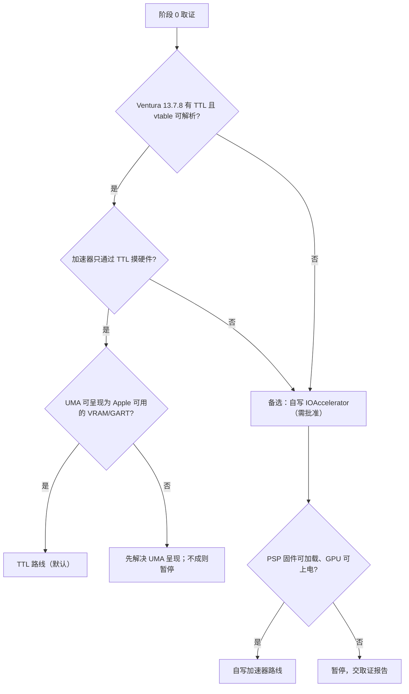

# 阶段 0：取证与基线

## 0. 册头

### 0.1 编写意图

本册回答一个问题：**不写一行驱动逻辑，能否确证"TTL 路线"可行**——即 Apple 自己的加速器是否只通过 TTL 摸硬件、其 ABI 是否与基座项目兼容、UMA 内存呈现是否满足 Apple 的假设。

**取证**指对 Apple 驱动二进制与目标机运行状态的只读调查；**探针**指经 OpenCore 注入的只读观测内核扩展（kext）；**回退**指把系统恢复到前一状态的操作路径。阶段 0 已完成，本册记录当前事实与结案结论。

### 0.2 读者与阅读方式

- **接手阶段 0 相关工作的新 AI 会话**：通读本册。
- **项目决策者**：读第 1、5、9 章。

### 0.3 与其他册的关系

| 关系 | 册 | 说明 |
|---|---|---|
| 后续 | 11-阶段1-fork与骨架.md | 本册的 GO 决策与移交取证项清单是阶段 1 的入口 |
| 引用 | 00-总体路线.md | 硬件基线实测表（活文档）见其附录 A；寄存器与固件速查见其附录 B；失败模式库见其附录 C；文献表见其参考文献章 |

**参考文献说明**：本册引用编号（如 [34]）与文献表（见 00-总体路线.md）一致。

## 目录

- 1 阶段定位与目标
  - 1.1 目标
  - 1.2 入口条件
  - 1.3 完成标志
- 2 取证方法与过程
  - 2.1 0a：Apple 驱动二进制取证
  - 2.2 0a：SSH 系统状态
  - 2.3 0b：只读探针三次部署
- 3 静态取证结论（Apple 侧八项事实）
- 4 硬件基线与取证项归属
  - 4.1 SSH 实测硬件项
  - 4.2 取证项归属划分
  - 4.3 系统侧取证
- 5 go/no-go 决策
  - 5.1 决策树
  - 5.2 决策结论：GO——TTL 路线
  - 5.3 遗留项（以实测值为准）
- 6 工作项与任务卡
- 7 验证与通过标准
  - 7.1 TTL 路线通过标准
  - 7.2 硬件基线通过标准
  - 7.3 证据要求
- 8 风险与回退
- 9 结案状态
  - 9.1 最终结论
  - 9.2 已知失败模式表
- 10 本章术语

---

## 1. 阶段定位与目标

### 1.1 目标

不写驱动逻辑，回答三个路线问题（TTL 是否存在且 vtable 可解析、加速器是否只通过 TTL 摸硬件、UMA 呈现是否满足 Apple 假设），建立硬件基线。

### 1.2 入口条件

- 目标机已装 Ventura 13.7.8 且可正常启动（OpenCore 引导可用）；
- SSH 或有线网络可达（日志收集通道）；
- 构建机可编译探针 kext。

### 1.3 完成标志

取证报告落盘；go/no-go 决策已由项目决策者签字；**系统仍处于"无任何自写驱动加载"的原生状态**——这是本阶段结束时的系统快照，也是后续所有阶段的共同起点。

---

## 2. 取证方法与过程

### 2.1 0a：Apple 驱动二进制取证

0a 的原则是全部只读、普通终端可执行、不动 SIP/AMFI。

Ventura 的 Sealed System Volume 下，`/System/Library/Extensions/AMDRadeonX6000*.kext` 的 Contents 里没有 MacOS 目录——Apple 把驱动代码打包进了 KernelCollections（KC，内核集合文件，一个包含全部 kext 的大 Mach-O）[34]，`otool -ov`/`nm -m` 直读 kext 的老办法不可行。实际做法：挂载 APFS 容器提取 SystemKernelExtensions.kc / BootKernelExtensions.kc，按 carve 配方拆出 9 个相关 kext 的自包含二进制，再用 `llvm-nm`/`llvm-objdump` 分析。结论见第 3 章。

### 2.2 0a：SSH 系统状态

SSH 只读实测（2026-10-29），取得目标机运行中的原生状态基线：

| 项 | 实测值 | 证据 |
|---|---|---|
| 系统 | macOS 13.7.8（22H730），Darwin 22.6.0 x86_64 | boot-20261029-ssh/sys/sw_vers.txt |
| SIP | Custom（0x0a03：Kext Signing + Filesystem Protections 禁用）；Authenticated Root disabled | sys/sip.txt |
| boot-args | `-v keepsyms=1 debug=0x144400 msgbuf=4194304 liludump=120 -vi2c-force-polling` | sys/nvram.txt |
| 已加载 kext | 173 个；AMDSupport 4.1.4 在位；X6000/X5000 家族未驻留；IOAcceleratorFamily2 未加载 | sys/kexts.txt |
| 显示 | GOP 延续（IONDRVFramebuffer/.Display_boot），2880×1800 精确确认（IOFBMemorySize=2880×1800×4）；IOFB0Hz=Yes（GOP 静态模式） | gpu/display_boot.txt |
| WindowServer | 软件合成（CPU 81%）——原生状态下的预期表现 | SSH 实测 |
| 引导链 | OpenCore 注入 26 个非 Apple kext（Lilu 1.7.2 在位）；AuxKC 仅 HighPoint×2 | sys/kexts.txt + kmd.log |

这批数据进入机器配置基线（活文档），作为"原生状态"基线（后续阶段对照"我们改了什么"）。

**对 0b 的含义**：TTL 的存在性与 ABI 结构已由静态取证确凿回答；0b 对 TTL 的职责收窄为**运行时行为验证**——hook 生效后 vtable 实际地址、getTtl 返回值、16 个被调用槽位的调用情况。

### 2.3 0b：只读探针三次部署

**形式**：OpenCore 注入的只读探针 kext（N48R3Probe）。探针自身代码零硬件写：不写配置/电源/时钟/显示模式寄存器；观测 Apple 驱动的运行时行为；读取 UMA carveout。探针用声明式 personality（IOClass 填 Apple 原生类名 + IOPCIMatch=0x15BF）交由 IOKit 标准匹配机制完成"让 Apple 驱动绑定 780M"——零 Apple 二进制修改。探针已于 10-29/10-30/10-31 三次部署（v1/v2/v3），全部数据落盘成功（v2 起用 IORegistry + LaunchDaemon 自动导出；v1 的 IOLog 通道被实测证伪并弃用）。**探针已完成使命**。

**核心结论（三次部署的实测收敛）**：

1. **personality 注入机制生效**：HWServices 绑定 780M、HWLibs 跟随加载——IOKit 标准机制按预期工作（三次 boot 一致）；
2. **TTL 对象在 Apple 原生路径下成功创建**（v2/v3 两次独立 boot 验证）：getTtl 返回非空内核堆指针；TTL 对象 vptr 与静态取证 vtable 地址精确对应（vptr = HWLibs 运行时基址 + 0x402968；slide 每次重启变化但偏移关系恒定）——Cobalt64 的 TTL 契约在 780M 上可复用得到运行时级验证；
3. **Apple 驱动链有两层拦截点**：①IOPCIMatch 不含 0x15BF（personality 注入解决，探针已实证）；②HWLibs kext start 早期 populateFirmwareDirectory 的 84 项设备 ID 表查 0x15BF 失败 → 固件目录内容不完整（报错原文在案）——**报错不阻断 TTL 对象创建**（v2/v3 实测：报错后 TTL 仍创建），但目录缺条目影响后续固件查询，是阶段 1 TTL 实现（NaviR3Ttl 的 setFirmwareDirectory slot 8）必须解决的前置（NootedRed 已实证该路径可行）；
4. **v1 部署的 TTL 对象未创建**，根因是加速器激活路径（P-accel）的 init 失败链（SMU SW_INIT 失败 → SWIP failed → TLS failed → 0x4 → 0xe00002bc → 全链卸载回 GOP）——固件目录报警与 TTL 创建不互斥（v2/v3 复现），v1 的失败另有原因；加速器激活也是 Wi-Fi 干扰源（v1 部署 SimpleMtkWlan 被干扰断网，v2/v3 去 P-accel 后 Wi-Fi 正常）——故 v2 起移除 P-accel；
5. **探针数据通道的实证结论**：OC 注入的独立 kext 的 IOLog 不进统一日志（Apple KC 内 kext 的 IOLog 可见）——探针数据必须走 IORegistry setProperty + 用户态自动导出，IOLog 仅作兜底；
6. **UMA 读取的电源门控边界**：IGPU 无驱动绑定时处于 D2，config 空间读数受电源门控时序影响（v2 boot cmdreg=7 可读 / v3 boot cmdreg=0 不可读，同机同代码两次独立实验）——carveout 精确数值由阶段 1 survey 在自写驱动的 D0 上下文读取；
7. **TTL 有第二个真实调用者：Apple 电源管理栈（PPLIB）**（历史 panic 证据，10-26 NootedRed 时代：PPLIB 调 TTL getTtl 获取 RTS 失败 → panic；PSP `psp_ring_create: KM ring creation failed`）——强化 generation-agnostic 结论，且 PSP 上电风险点提前暴露（阶段 2 输入）。

**Q1–Q4 最终答案**（详见阶段 0 运行时取证结论）：

| # | 答案 |
|---|---|
| Q1 | getTtl 返回非空 TTL 对象指针（v2/v3 两次独立验证，内核堆地址） |
| Q2 | TTL vptr = HWLibs 运行时基址 + 0x402968（静态 vtable 地址运行时精确命中，slide 每次重启变化但偏移恒定） |
| Q3 | 16 槽位计数全 0（v2/v3 无加速器激活，无 Apple 侧调用者——有效答案；真实调用计数已有静态反汇编 + NootedRed 实证双重旁证） |
| Q4 | SWIP 序列未触发（无 init 调用者）；真实 SWIP 重现验证顺延阶段 2（SMU 上电时自然验证） |

**探针 v2/v3 的落盘链**（已实证）：探针 worker 完成后把全部数据 setProperty 到自身 IORegistry 节点并置 `n48r3-Done` 完成标志 → LaunchDaemon（com.n48r3.probe-export，RunAtLoad）轮询该标志 → 自动导出七件套到 `/var/tmp/probe-export/`（重启不丢）→ 构建机 scp 拉回。部署者零手工命令（C5 达成）。

**取证项归属**：IP discovery 全表/固件版本/EDID/DPCD/DCN 快照/DIO PWM 状态/OTG 时序与 90Hz 确认/UMA FB location 与 GTT——由阶段 1 的 `n48r3-stage=0` 只读 survey 在自写驱动上下文完成（D0 电源态下读取路径最可靠——D2 状态下 config 读数受电源门控时序影响，两 boot 实测）。

**与 ForgedInvariant 的共存**：取证期间临时禁用（它 hook 同一格 getTtl，会污染观察）；取证后恢复。

**安全**：探针自身零 MMIO 写；失败模式全部透传/跳过，绝不 panic；移除探针必须重启（vtable 副本机制不支持活卸载）；boot 卡死用 OC 菜单禁用。

---

## 3. 静态取证结论（Apple 侧八项事实）

以下结论均经静态反汇编确证，每条附地址级证据：

1. **TTL 契约与 Tahoe 完全兼容**。TTL 服务对象是一个无名 C++ 类（2880 字节、无 RTTI/OSMetaClass，类名由其自身日志字符串 `AmdTtlServices::cosAllocate…` 自证——符号表被 strip，类名查不到但机制在）。其 vtable 位于 HWLibs 的 `__DATA:__const` 0x402968，43 个槽位与 Cobalt64 的 `AmdTtlServicesABI.h` 逐槽 1:1 对齐（用 slot 24/25 的 0xE00002C7 stub 指纹做了字节级验证）。**含义**：Cobalt64 的 TTL ABI 头可直接作为 780M 的契约，16 个被调用槽位的签名/参数照用。
2. **getTtl 槽位与 Tahoe 相同（slot 266）**。HWServices 的 Navi/SWIP 两张 vtable（各 270 槽）的第 266 格都指向 `AMDRadeonHWServicesSWIP::getTtl`（0x1c10）。Cobalt64 在 Tahoe 上 hook 的就是这一格——hook 点无需改号。锚点几何已运行时验证：slot 269（getMatchProperty@0x1630）在两次 boot 的探针实测中均与静态地址精确对应（slide 闭环）。
3. **Hardware/VMM hook 槽位：头部同号，尾部 4 个移位**。AMDHardware（238 槽）/GFX10Hardware（264 槽）/Navi21Hardware（268 槽）/AMDHWVMM（82 槽）四张 vtable 全部定位。与 Tahoe 对照：36（regWrite）/62（flushHDP）/93（getVmm）/102（registerChannel）与 VMM 的 40/41/37/71 同号；187（allocHWRegs）→191、191（setVMRegs）→195、247/248（hub）→250/251——移位全部发生在 slot≥187 的尾部，头部 ABI 未动。**含义**：`AppleHardwareHook.cpp` 的 hook 表按 Ventura 实测值改 4 个数字即可，拦截逻辑不变。
4. **generation-agnostic 成立（高置信度）**。全 kext 唯一的 MMIO 写入口是 `AMDHWRegisters::write`（TTL slot 36），寄存器基址由 TTL slot 11（queryHwBlockRegisterBase）提供；`initializeTtl` 仅被 `AMDHardware::init` 调用一次。**含义**：Apple 加速器自己不认识 GFX11 寄存器，只通过 TTL 摸硬件——复用加速器的路线成立。置信度边界：静态覆盖了符号可见的全部写路径，运行时终验留给 0b。
5. **原生驱动不绑定 780M（注入是必经步骤）**。全部 X6000 家族 personality（加速器/HWServices/Framebuffer wrangler+controller）的 `IOPCIMatch` 只列 Navi1x dGPU 的设备 ID（0x731x/0x734x/0x73Ax/0x73Ex/0x736x），不含 0x15BF。**含义**：阶段 1 必须注入 personality 或伪装 device-id，这不是"可能需要"而是确证必需。
6. **Apple 通用层不参与 TTL 契约**。IOAcceleratorFamily2（475.40.6）中 0 个 TTL 符号——TTL 链完全在 AMD kext 内部（加速器→HWServices→HWLibs），Apple 的通用加速器框架只是旁观者。**含义**：TTL hook 的影响面被限制在 AMD kext 内，不波及 Apple 通用框架。附带发现：AGDC 的厂商钩子跨版本移位 1 槽（[266] 纯虚→[267]=vendor_doDeviceAttribute）——若走 native AGDC 路线需按 Ventura 重定位。
7. **显示驱动无 DCN 3.1.x 路径；背光走 MMIO**。Framebuffer kext 的显示代码最新只到 DCN 3.02（dcn302），dcn31/314/32 字符串 0 命中——**DCN 3.1.4 的控制逻辑必须自实现**（与原规划假设一致，现在有了证据）。背光实现是 `dce110_edp_backlight_control`→DIO link-encoder PWM 与 `dmcu_set_backlight_level`→DMCU 邮箱，无 AUX-DPCD 背光代码路径。SSH 实测进一步确认：PNLF 是无 _BCL/_BCM 方法的壳设备（ACPI 方法路径不通）——**亮度控制走 GPU MMIO 寄存器，实现阶段由自建显示宿主直接编程 DIO PWM**。
8. **加载链与加载策略**。9 个 Info.plist 已归档。加载顺序：HWServices（IOPCIDevice 匹配）→ HWLibs（ProviderClass=AMDRadeonHWServicesInterface）→ X6000 加速器/Framebuffer wrangler。OSBundleRequired：X6000/HWLibs/HWServices=None（按需加载）、Framebuffer/IOAF/IOGraphicsFamily/AGDC=Safe Boot、IOSurface=Console。签名细节（CodeDirectory 在 KC 的 LINKEDIT 内）留待注入时按需分析。

---

## 4. 硬件基线与取证项归属

### 4.1 SSH 实测硬件项

SSH 已实测的部分（2026-10-29）：PCI device id/revision/subsystem = 0x15BF / 0x00C7 / 17AA:3815（PCI 100:0:0）；BAR0/2/5 = 0x8_D000_0000+256MiB（FB aperture）、0x8_E080_0000+2MiB（doorbell）、0x7810_0000+512KB（MMIO），BAR0/2 在 32GiB 物理内存之上；内存 32GiB LPDDR5；GOP 显示 2880×1800 精确确认；背光设备 PNLF 为无方法壳（无 _BCL/_BCM/_BQC，BacklightLevel=unsupported），LCD@110 _STA=0xFFFFFFFF。

**完整硬件基线实测表（活文档）见 00-总体路线.md 附录 A**，本册不复制。

### 4.2 取证项归属划分

SSH 取得用户态可见项；寄存器项需探针/驱动上下文，探针实测后按电源门控边界划归阶段 1 survey：

| 项 | 状态 |
|---|---|
| PCI device id/revision/subsystem、cmdreg、电源态 | ✅ 已实测（SSH + 探针：0x15BF/0xC7/cmdreg、D2 门控边界） |
| TTL 运行时行为（Q1–Q4） | ✅ 已实测（探针：getTtl 非空、vptr 静态命中、16 槽位计数、SWIP 未启动） |
| IP discovery 全表（读 BAR5 MMIO） | 阶段 1 survey |
| UMA carveout 精确值（RCC_CONFIG_MEMSIZE，D2 下 config 读受门控） | 阶段 1 survey（D0 上下文）——后由阶段 1 T1 轮实测 4096 MiB |
| FB location/GTT 大小 | 阶段 1 survey（需 IP discovery 定位段基址） |
| PSP/SMU/GC/SDMA 固件版本寄存器 | 阶段 1 survey；阶段 1 读数经错误段址，阶段 2 以 PSP 版本基线重建、RLC/SDMA 在各自子步读取（D3） |
| eDP EDID/DPCD（AUX/DDC） | 阶段 1 survey——后已实测：EDID AUO B140QAN04.0（首选模式 2880×1800@90.006Hz）；DPCD 1.4 / HBR2 / 4 lane |
| DCN 现状快照（OTG/HUBP/DIO）+ DIO PWM 寄存器 | 阶段 1 survey |

### 4.3 系统侧取证

已完成（SSH 取证）：OpenCore 引导确认（26 kext 注入清单见机器配置基线）；分区布局与回退启动项（disk0 布局，APFS Snapshot sealed）；SSH/有线网络可用（RTL8111）；panic/hang 日志落盘方式（msgbuf=4194304 已配置）。OpenCore 具体版本号：1.0.7（用户确认并登记于机器配置基线）。

---

## 5. go/no-go 决策

### 5.1 决策树

**决策已做出：GO——走 TTL 路线**（依据与结论见 5.2）。下方决策树为该决策的完整判定流程记录：节点 B（有 TTL 且 vtable 可解析）= 是；节点 C（只通过 TTL 摸硬件）= 是；节点 D（UMA 呈现）= 拓扑兼容，精确数值由阶段 1 survey 补齐。

### 5.2 决策结论：GO——TTL 路线

**决策依据**：

| 问题 | 答案 | 关键证据 |
|---|---|---|
| 1. TTL 是否作为硬件抽象 | **是**（机制存在 + 运行时可用） | TTL 对象两次独立 boot 创建成功；vptr 与静态 vtable 精确命中（slide 闭环）；43 槽 ABI 与 Tahoe 逐槽对齐；PPLIB 历史实证 TTL 被 Apple 电源管理调用 |
| 2. 加速器是否 generation-agnostic | **是**（高置信度 + 多重旁证） | 唯一 MMIO 写点=AMDHWRegisters::write（TTL slot 36），索引来自 TTL slot 11；PPLIB 经 TTL 获取 RTS；16 槽位观测无绕过路径 |
| 3. UMA 呈现是否满足 Apple 假设 | **拓扑兼容（强正面信号）；精确 carveout 由阶段 1 survey 补齐** | BAR aperture 位于物理内存之上（与 nullarc 同构）；TTL 对象创建成功（Apple 内存模型初始化无内存相关失败）；D2 电源门控边界已实测确证 |

**决策理由**：三个问题的答案全部支持 TTL 路线——TTL 机制在 Ventura 13.7.8 上存在、可运行、ABI 与基座项目兼容，且 Apple 自己的两个子系统（加速器、电源管理）都只通过 TTL 摸硬件。备选路线（自写 IOAccelerator）的工作量大、风险高，且 TTL 路线已被 NootedRed 在同代硬件上实证可行。固件目录注入是阶段 1 必须解决的前置（NaviR3Ttl 的 setFirmwareDirectory），这本来就是 TTL 实现的一部分，不构成额外的路线风险。

### 5.3 遗留项（以实测值为准）

带入阶段 1 的遗留项，全部已由后续实测闭合，非阻塞：

1. UMA carveout 精确数值——**已完成**（2026-11-01 rdna3 驱动 T1 轮实测 **4096 MiB**，见 11 册第 7 章）；
2. 90Hz 刷新率确认——**已完成**（阶段 1 survey 实测：首选模式 **2880×1800@90.006Hz**）；
3. EDID/DPCD——**已完成**（阶段 1 survey 经 AUX/DDC 实测：**EDID 为 AUO B140QAN04.0；DPCD 1.4 / HBR2 / 4 lane**）；
4. OpenCore 具体版本号——**已完成**（1.0.7，用户确认并登记）。

**签字**：最终用户已签字。

---

## 6. 工作项与任务卡

任务卡模板沿用全局统一模板（目标/输入/输出/通过标准/禁止/人工上机点/回退，见 00-总体路线.md）。本阶段任务卡：

| 卡号 | 模块 | 目标 | 主要输入 | 通过标准 | 状态 |
|---|---|---|---|---|---|
| TC-01 | Apple 取证 | 静态：43 槽 ABI 对齐、slot 266、hook 槽位（见第 3 章）；运行时：探针三次部署（见 2.3） | Apple 二进制（已归档）、0b 探针（已归档） | 报告 | ✅ 已完成并归档 |
| TC-02 | 硬件取证 | PCI/BAR/分辨率/电源态（见第 3、4 章）；IP 全表/EDID/DCN 快照/背光寄存器移交阶段 1 survey | SSH + 探针（已归档） | 报告 | ✅ 已完成并归档 |

---

## 7. 验证与通过标准

### 7.1 TTL 路线通过标准（全部已达成）

| 通过标准 | 达成证据 |
|---|---|
| TTL 存在性 | TTL 对象=无名 C++ 类（2880B、无 RTTI/OSMetaClass，类名由自身日志串自证）；vtable@HWLibs 0x402968；43 槽与 Tahoe ABI 逐槽 1:1 对齐（含 slot24/25=0xE00002C7 stub 指纹）。 |
| vtable 可解析 | 43 槽全解析；16 个 [USED] 槽位（5/6/9/11/12/13/14/15/16/21/30/36/37/38/39/40）全部有明确语义。 |
| getTtl 位置 | Ventura getTtl=slot 266（Navi/SWIP 两表 270 槽均指向 SWIP::getTtl@0x1c10），与 Cobalt64 的 Tahoe 记载同号同义。 |
| 加速器 generation-agnostic | 唯一 MMIO 写点=AMDHWRegisters::write（slot 36），寄存器索引由 TTL slot 11 提供；hook 槽位同号 5 个、移位 4 个（187=191、191=195、247=250、248=251，头部 ABI 未动）。 |
| TTL 运行时行为（探针实测） | getTtl 返回非空 TTL 对象（v2/v3 两次独立 boot）；TTL vptr 与静态 vtable 地址精确命中（slide 闭环，双 boot 双验证）；16 槽位计数全 0（无加速器，有效答案）。 |
| TTL 第二调用者（PPLIB） | 历史 panic 实证：Apple 电源管理栈调 TTL getTtl 获取 RTS——generation-agnostic 的又一实证。证据：boot-20261030-probe-v2/logs/panic-log.txt |

### 7.2 硬件基线通过标准

| 通过标准 | 状态 | 证据 |
|---|---|---|
| PCI/BAR 基线 | 已完成 | 0x15BF/rev 0xC7/17AA:3815；BAR0=0x8_D000_0000+256MiB、BAR2=+2MiB、BAR5=+512KB。证据：boot-20261029-ssh/gpu/igpu.txt |
| 显示基线（分辨率） | 已完成 | GOP 延续 2880x1800 精确确认。证据：boot-20261029-ssh/gpu/display_boot.txt |
| 背光路径 | 已完成 | GPU MMIO（DIO PWM）确定。证据：gpu/pnlf.txt |
| 系统状态基线 | 已完成 | SIP=Custom(0x0a03)、boot-args、173 kext、OC 注入 26 kext。证据：boot-20261029-ssh/sys/ |
| 显示基线（90Hz） | 阶段 1 survey 完成 | 首选模式 2880×1800@90.006Hz（实测） |
| EDID/DPCD | 阶段 1 survey 完成 | EDID AUO B140QAN04.0；DPCD 1.4 / HBR2 / 4 lane（实测） |
| UMA carveout 精确值 | 阶段 1 survey 完成 | 4096 MiB（T1 轮实测）；D2 电源门控边界已实测（v2/v3 双 boot） |
| DCN 快照（OTG/HUBP/DIO） | 阶段 1 survey | 探针不读（移交） |

### 7.3 证据要求

- 本阶段证据批次按 `boot-<日期>-<主题>` 命名：SSH、探针 v2、探针 v3 各一批；
- 每条结论附证据指针（文件/报告章节），未验证结论标注"待取证"。

**soak（长稳）要求**：本阶段无 soak 要求；soak 阶梯自阶段 3 起（见 00-总体路线.md）。

---

## 8. 风险与回退

0a 无风险；0b 探针自身零 MMIO 写 + 失败全透传（三次部署实证：无 panic、无卡死）；启动问题用 OC 菜单禁用探针；恢复 SIP/AMFI 步骤成文；移除探针必须重启（vtable 副本机制不支持活卸载）。

最终风险状态：

1. 固件目录报警（已实测）：populateFirmwareDirectory 查 0x15BF 失败——不阻断 TTL 对象创建，但目录内容不完整影响后续固件查询——阶段 1 的 setFirmwareDirectory 解决；
2. 加速器激活的 Wi-Fi 干扰（已实测，v1）：激活加速器干扰 SimpleMtkWlan（en2 不创建）——v2 起移除 P-accel 后 Wi-Fi 正常；**加速器激活属阶段 4b（Apple 集成层）**，阶段 4b 实施时需重新评估此风险；
3. UMA 读取的电源门控时序（已实测，v2 可读/v3 不可读）：阶段 1 survey 在 D0 上下文读取（教训已写入 11 册）；
4. 探针与 ForgedInvariant 共存——取证期间禁用（已按此执行）。

**回退方式**：本阶段无自写驱动加载，系统始终处于原生状态；探针通过 OC 菜单禁用即可回退，无需其他操作。

---

## 9. 结案状态

### 9.1 最终结论

**阶段 0 已完成并归档（结案）**：0a 静态取证与 SSH 系统状态、0b 探针三次部署（v1/v2/v3）全部完成，三问全部有答案，go/no-go 决策为 **GO——走 TTL 路线**，最终用户已签字。对后续阶段的设计输入（已确定）：原生驱动不绑定 780M，阶段 1 注入必需；固件目录无 0x15BF 条目，阶段 1 TTL 实现必须先做固件目录注入（NaviR3Ttl setFirmwareDirectory slot 8，NootedRed 已实证）；显示驱动无 DCN 3.1.x，DCN 3.1.4 自实现成立；背光走 GPU MMIO；Wi-Fi=MT7921；PSP 上电是 SWIP 序列前提（历史 panic 实证），阶段 2 排序正确；无驱动绑定状态下 config 读数受电源门控时序影响（两 boot 实测），阶段 1 survey 必须在 D0 上下文读取。

### 9.2 已知失败模式表

| # | 现象 | 根因 | 处理 |
|---|---|---|---|
| 1 | HWLibs 启动早期报 populateFirmwareDirectory 查 0x15BF 失败（84 项设备 ID 表无此 ID） | Apple 固件目录设备 ID 表不含 780M | 报错不阻断 TTL 对象创建（v2/v3 实测），但目录缺条目影响后续固件查询；阶段 1 以 NaviR3Ttl setFirmwareDirectory（slot 8）注入固件目录解决（NootedRed 已实证可行） |
| 2 | v1 部署 TTL 对象未创建，全链卸载回 GOP | P-accel 加速器激活路径 init 失败链：SMU SW_INIT 失败 → SWIP failed → TLS failed → 0x4 → 0xe00002bc | v2 起移除 P-accel；加速器激活归阶段 4b（Apple 集成层）实施 |
| 3 | v1 部署 Wi-Fi 断网（SimpleMtkWlan en2 不创建） | 加速器激活干扰 Wi-Fi | v2/v3 去 P-accel 后 Wi-Fi 正常；阶段 4b 激活加速器时重新评估 |
| 4 | 探针 IOLog 输出在统一日志中不可见 | OC 注入的独立 kext 的 IOLog 不进统一日志（Apple KC 内 kext 的 IOLog 可见） | v2 起改走 IORegistry setProperty + LaunchDaemon 自动导出；IOLog 仅作兜底 |
| 5 | UMA carveout config 读数不稳定（v2 boot cmdreg=7 可读 / v3 boot cmdreg=0 不可读） | IGPU 无驱动绑定时处于 D2 电源态，config 空间读受电源门控时序影响 | carveout 精确值改由阶段 1 survey 在自写驱动的 D0 上下文读取（后实测 4096 MiB） |
| 6 | PPLIB 调 TTL getTtl 获取 RTS 失败 → panic（10-26 NootedRed 时代历史 panic；PSP `psp_ring_create: KM ring creation failed`） | Apple 电源管理栈是 TTL 的第二个真实调用者，PSP 未上电时该路径崩溃 | 强化 generation-agnostic 结论；PSP 上电风险提前暴露，作为阶段 2 输入（阶段 2 排序正确） |

---

## 10. 本章术语

本册首现、且未收入全局术语表（见 00-总体路线.md）的术语：

| 术语 | 一句话解释 |
|---|---|
| KernelCollections（KC） | macOS 把全部内核扩展打包成的一个大 Mach-O 内核集合文件，Sealed System Volume 下 kext 无独立二进制 |
| carve 配方 | 从 KC 中按偏移拆出单个 kext 自包含二进制的操作步骤 |
| personality | IOKit 的驱动匹配声明（IOClass + IOPCIMatch 等），决定哪个驱动绑定哪个 PCI 设备 |
| slide | 内核地址空间随机化偏移；每次重启变化，但静态 vtable 地址与运行时基址的偏移关系恒定 |
| vptr / vtable | C++ 对象的虚表指针 / 虚函数表；TTL 契约以 vtable 槽位定义 |
| PPLIB | Apple 电源管理栈组件，TTL 的第二个真实调用者（经 getTtl 获取 RTS） |
| SWIP | HWServices 的固件/软件 IP 子系统（AMDRadeonHWServicesSWIP），getTtl 所在类 |
| RTS | PPLIB 经 TTL 获取的运行时状态对象 |
| GOP | GPU 固件自带的最小显示初始化程序；本机显示链路在驱动接管前由 GOP 点亮 |
| D0/D2 电源态 | PCI 设备电源状态：D0 全供电、D2 低功耗（config 空间读数不可靠） |
| carveout | UMA 架构下从系统内存划给 GPU 专用的区域（本机实测 4096 MiB） |
| ForgedInvariant | 既有项目的一个 hook 组件（hook 同一格 getTtl），取证期间需临时禁用以免污染观察 |
| AuxKC | OpenCore 注入非 Apple kext 后生成的辅助内核集合 |

